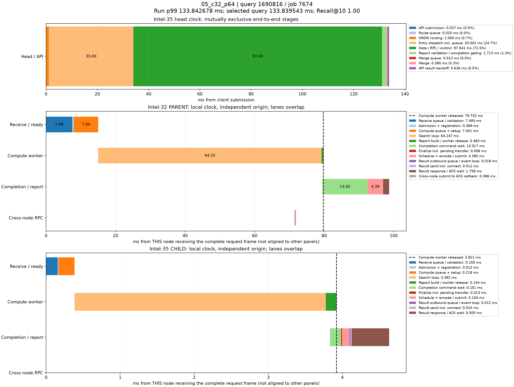

# p99真实查询时序分解

来源：05_c32_p64，10000条查询。选择全体查询中服务延迟最接近本轮p99的记录；不筛选跨节点条件，也不使用多轮p99均值选择样本。

本轮p99为133.842677650ms；query_id=1690816、job=7674，延迟133.839543000ms，相差0.003134650ms，Recall@10=1.00。

顶层面板使用同一主机时钟，阶段互斥且总和等于端到端服务延迟。每个数据节点单独以收到完整报文为零点，不能跨主机直接对齐时间轴或相加。节点内计算、控制、派发存在重叠；虚线表示计算线程释放时刻，之后的控制/网络等待不占用该计算线程。结果ACK时刻与用户Future完成时刻也不同。

|顶层阶段|耗时ms|占服务延迟|
|---|---:|---:|
|API submission|0.036685|0.03%|
|Route queue|0.019569|0.01%|
|HNSW routing|0.999798|0.75%|
|Entry dispatch incl. queue|33.001667|24.66%|
|Data / RPC / control|97.040579|72.51%|
|Report validation / completion gating|1.712719|1.28%|
|Merge queue|0.012725|0.01%|
|Merge|0.379547|0.28%|
|API result handoff|0.636254|0.48%|

## Intel-32 / PARENT

|阶段|本节点相对起点ms|耗时ms|
|---|---:|---:|
|Receive queue / validation|0.000000|7.492896|
|Admission + registration|7.492896|0.468606|
|Compute queue + setup|7.961502|7.040504|
|Search loop|15.002006|64.247248|
|Report build / worker release|79.249254|0.482837|
|Completion command wait|79.477574|13.017465|
|Finalize incl. pending transfer|92.495039|0.008370|
|Schedule + encode / submit|92.503409|4.385395|
|Result outbound queue / event loop|96.888804|0.017503|
|Result send incl. connect|96.906307|0.011644|
|Result response / ACK wait|96.917951|1.758183|
|Cross-node submit to ACK callback|71.480051|0.385509|

## Intel-35 / CHILD

|阶段|本节点相对起点ms|耗时ms|
|---|---:|---:|
|Receive queue / validation|0.000000|0.155262|
|Admission + registration|0.155262|0.011705|
|Compute queue + setup|0.166967|0.217902|
|Search loop|0.384869|3.392128|
|Report build / worker release|3.776997|0.144384|
|Completion command wait|3.831149|0.150851|
|Finalize incl. pending transfer|3.982000|0.013197|
|Schedule + encode / submit|3.995197|0.103903|
|Result outbound queue / event loop|4.099100|0.012200|
|Result send incl. connect|4.111300|0.014907|
|Result response / ACK wait|4.126207|0.504903|

结果RPC排队起点由 sender_enter_ns - round(pool_wait_ms * 1e6) 还原；pool_wait_ms来自底层同一主机时钟的queued_ns与send_start_ns之差。旧message_ready_ns是在异步提交成功后记录，网络线程可能已开始发送，不能用它直接计算发送前队列。还原数值保存在stages.json/CSV，未改写原始时间戳。

接收队列/验证、完成控制和发送前等待均为观测区间，可能包含OS调度及状态锁等待，不能据图将其全部认定为锁、CPU计算或纯链路传输。单条p99附近查询用于定位现象，不代表所有尾延迟样本。selected.json保留完整源记录，stages.json/CSV保存精确阶段数值。
