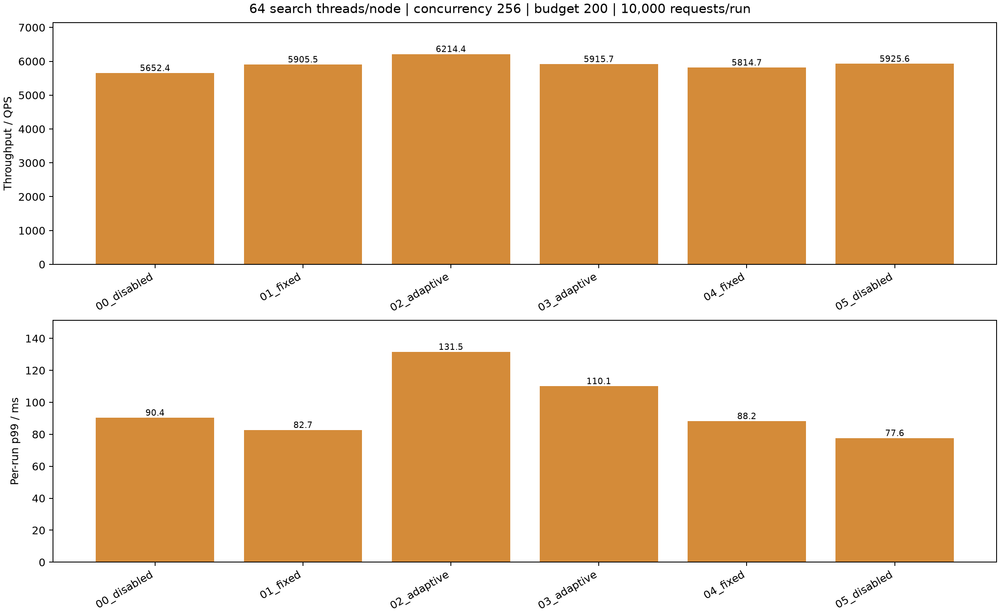
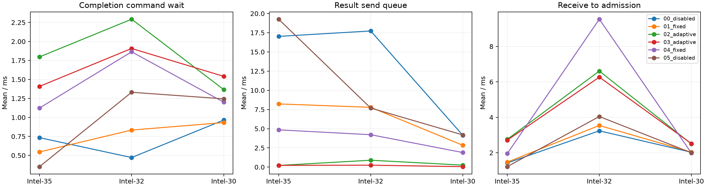

# 统一网络模块三机对照实验

固定三机Intel-35/32/30，每节点64查询线程、并发256、搜索预算200、合并线程4、预热32。每轮10000请求（相同2000查询重复5次）。固定顶层路由16线程/每目标连接32，三组分别为关闭模块资源策略、固定单循环、收发各1至4循环动态扩缩容。adaptive_control全程关闭；固定/动态组每循环每目标连接32，关闭组保留旧通道配置。

|轮次|路由线程|顶层连接/目标|QPS|p99 ms|平均ms|Recall@10|
|---|---:|---:|---:|---:|---:|---:|
|00_disabled|16|32|5652.38|90.37|44.41|0.97019|
|01_fixed|16|32|5905.45|82.70|42.69|0.97021|
|02_adaptive|16|32|6214.41|131.54|40.56|0.97043|
|03_adaptive|16|32|5915.70|110.10|42.74|0.97029|
|04_fixed|16|32|5814.71|88.23|42.82|0.97038|
|05_disabled|16|32|5925.64|77.64|42.40|0.97015|

## 分阶段等待

以下为每查询均值，单位ms。发送前排队为RPC提交至网络客户端分配处理的间隔，混合连接容量等待与事件循环调度；响应等待包含远端处理与网络事件循环，不能称为纯网络耗时。派发/响应与数据执行重叠，不能相加为总延迟。

|轮次|路由队列|路由执行|入口发送前排队|入口发送含连接|入口响应等待|数据与控制|计算就绪累计|搜索执行累计|搜索CPU累计|
|---|---:|---:|---:|---:|---:|---:|---:|---:|---:|
|00_disabled|0.095|0.821|0.923|0.043|2.920|42.416|0.904|11.502|11.398|
|01_fixed|0.100|0.757|0.864|0.066|3.091|40.377|1.145|11.310|11.197|
|02_adaptive|0.099|0.794|0.163|0.025|5.402|24.565|1.942|11.567|11.456|
|03_adaptive|0.137|0.843|0.774|0.129|5.948|24.468|1.692|11.706|11.582|
|04_fixed|0.059|0.811|2.082|0.047|4.869|38.926|1.522|11.629|11.517|
|05_disabled|0.123|0.796|0.249|0.028|2.927|40.460|1.080|11.388|11.277|

## 负载

CPU核数为进程CPU时间除以快照窗口，数据节点窗口包含快照采集时间，不能用作精确瞬时CPU饱和度。

|轮次|Intel-35数据CPU核|Intel-32数据CPU核|Intel-30数据CPU核|顶层CPU核|物理读字节|
|---|---:|---:|---:|---:|---:|---:|
|00_disabled|18.53|18.03|10.16|13.06|0|
|01_fixed|17.39|17.88|9.90|13.20|0|
|02_adaptive|19.20|19.77|10.83|15.34|0|
|03_adaptive|19.15|19.50|10.87|14.85|0|
|04_fixed|17.03|18.42|9.71|13.33|0|
|05_disabled|18.38|19.10|10.50|13.03|0|

## 验证与边界

全部结果通过零失败、预算/无重复访问/无路由扩展审计，真实数据线程数64，暂存没有触发容量溢出。服务时延以完整原生结果交付Future为终点，后置编码、JSON持久化与统计不计入QPS。每轮仅数秒，是热缓存短测；两轮均值不能证明统计显著性。原始时间戳、有效YAML、源码快照和审计均保存在各轮目录。未修改生产配置或搜索代码。

## 实际扩容及等待

以下为正式查询对应的分支/结果事件均值（ms），不是所有分支之和。不同区间可能重叠。

|轮次|节点|结果发送峰值循环|结束循环|进程线程数|完成命令等待|结果发送前队列|接收至接纳|
|---|---:|---:|---:|---:|---:|---:|---:|
|00_disabled|0|1|1|76|0.734|17.020|1.422|
|00_disabled|1|1|1|76|0.472|17.728|3.238|
|00_disabled|2|1|1|76|0.965|4.146|2.027|
|01_fixed|0|1|1|79|0.546|8.227|1.470|
|01_fixed|1|1|1|79|0.834|7.785|3.539|
|01_fixed|2|1|1|79|0.932|2.841|2.036|
|02_adaptive|0|3|1|100|1.797|0.215|2.758|
|02_adaptive|1|3|1|98|2.293|0.894|6.611|
|02_adaptive|2|2|1|100|1.366|0.255|2.495|
|03_adaptive|0|4|2|103|1.409|0.225|2.707|
|03_adaptive|1|3|1|100|1.908|0.248|6.267|
|03_adaptive|2|3|2|101|1.541|0.058|2.516|
|04_fixed|0|1|1|79|1.124|4.849|1.950|
|04_fixed|1|1|1|79|1.864|4.217|9.538|
|04_fixed|2|1|1|79|1.201|1.893|1.981|
|05_disabled|0|1|1|76|0.352|19.261|1.215|
|05_disabled|1|1|1|76|1.331|7.687|4.045|
|05_disabled|2|1|1|76|1.245|4.187|1.996|

## 结论与默认配置

|配置|QPS 两轮均值|每轮 p99 的均值 ms|平均延迟 ms|
|---|---:|---:|---:|
|关闭模块资源策略|5789.01|84.01|43.41|
|固定单事件循环|5860.08|85.47|42.75|
|收发动态 1–4 循环|6065.05|120.82|41.65|

动态相对固定组 QPS 增加 3.50%，但每轮 p99 均值增加 41.36%。这两轮短测不支持按用户优先p99的标准默认开启自动扩容。模板继续 enabled=false；可以将min=max固定资源做实验。p99列是两轮分位数的算术平均，不是合并全部样本的p99。

结果发送前排队在动态组明显降低：各节点/轮次均值0.06–0.89ms，而固定组为1.89–8.23ms。数据及控制区间缩短，但合并队列等待均值变为14.28/16.33ms，固定组为0.64/2.18ms；顶层进程CPU核数也由约13.2增至14.9–15.3。这说明局部发送等待下降没有等量转化为端到端收益。当前数据不足以将合并排队唯一归因于CPU争用、请求到达突发或特定状态锁，需要保持其他池不变进一步消融。

动态扩容只观察pending/handler队列，没有内置端到端p99反馈或进程总CPU预算。下一步候选为更小的网络上限、按通道设置独立策略和接收/合并配额联动；当前没有自动实施这些额外策略。

## 数据节点发送模块的实际伸缩

|轮次|节点|邻居派发峰值/结束|结果回传峰值/结束|派发扩/缩次数|回传扩/缩次数|
|---|---:|---:|---:|---:|---:|
|00_disabled|0|1/1|1/1|0/0|0/0|
|00_disabled|1|1/1|1/1|0/0|0/0|
|00_disabled|2|1/1|1/1|0/0|0/0|
|01_fixed|0|1/1|1/1|0/0|0/0|
|01_fixed|1|1/1|1/1|0/0|0/0|
|01_fixed|2|1/1|1/1|0/0|0/0|
|02_adaptive|0|3/1|3/1|2/2|2/2|
|02_adaptive|1|2/1|3/1|1/1|2/2|
|02_adaptive|2|3/1|2/1|2/2|1/1|
|03_adaptive|0|4/1|4/2|3/3|3/2|
|03_adaptive|1|2/1|3/1|1/1|2/2|
|03_adaptive|2|3/1|3/2|2/2|2/1|
|04_fixed|0|1/1|1/1|0/0|0/0|
|04_fixed|1|1/1|1/1|0/0|0/0|
|04_fixed|2|1/1|1/1|0/0|0/0|
|05_disabled|0|1/1|1/1|0/0|0/0|
|05_disabled|1|1/1|1/1|0/0|0/0|
|05_disabled|2|1/1|1/1|0/0|0/0|

六轮全部60000正式请求成功，Recall@10为97.015%–97.043%，全部协议审计通过；未发生内存暂存溢出。物理磁盘读增量均为0，数据由缓存提供，本实验不用于论证冷SSD性能。

可复现入口为experiment.py和run_sweep.py，三机版本校验保存在provenance.log和各case的deployed_provenance.json。原始JSON分片压缩前后校验SHA256，archive_manifest.json记录完整性；queries.jsonl.gz保留用于分析。已有220xx服务未替换。

六轮比较完成后，补充将接收池和顶层池统计接入管理快照（managed_node.py/cpp_runtime.py/managed_cluster.py），没有改动C++收发或搜索实现。补充验证使用06_observe，单独记录，不混入上述六轮对照。

## 最终版本接收/发送可观测性验证

06_observe在补充管理快照后单独运行10000请求：QPS 6496.24，p99 108.74ms，Recall@10 0.97037，零失败、审计通过。它不计入前述双轮均值。

|模块|峰值循环|快照时循环|扩容次数|回收次数|
|---|---:|---:|---:|---:|
|顶层入口发送|4|1|3|3|
|顶层租约发送|1|1|0|0|
|顶层报告接收|4|1|3|3|
|节点0接收|4|4|3|0|
|节点0邻居派发|4|1|3|3|
|节点0报告发送|3|1|2|2|
|节点1接收|4|4|3|0|
|节点1邻居派发|3|1|2|2|
|节点1报告发送|3|1|2|2|
|节点2接收|4|4|3|0|
|节点2邻居派发|3|1|2|2|
|节点2报告发送|3|1|2|2|

快照在查询结束后采集，各主机采集时刻不相同。保留的持久连接可能延后接收侧回收，因此不能要求发送缩回时接收也已经缩回。底层TCP专项测试另验证排空后回到最小循环数和同端口继续服务。

最终回归记录regression_verified.log：444项中442通过、2跳过。补充指标时曾遗漏Python NativeServer封装的metrics转发方法，回归捕获后已修复，失败记录regression_final.log保留；修复后的最终版本再次全量通过。
