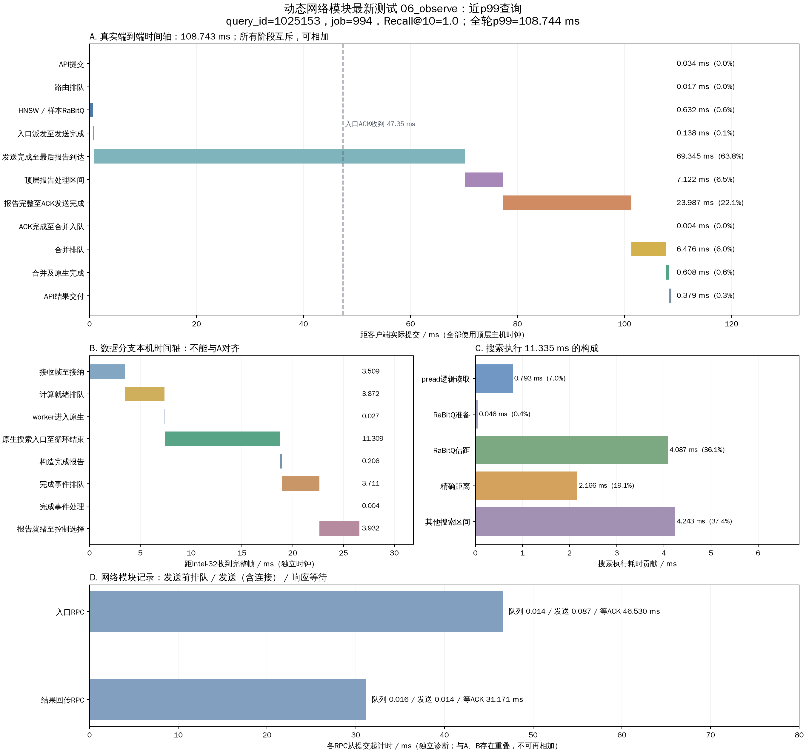

# 动态网络模块最新测试：接近 p99 的单查询时延

从最新完成的 `three/06_observe` 测试中，选择客户端延迟最接近本轮 p99 的实际请求。共 10,000 个请求，p99 为 **108.744012 ms**；选中请求耗时 **108.742730 ms**，相差 0.001282 ms。分位数由 NumPy 默认线性插值得出，因此实际请求不必恰好等于 p99。

- query_id：`1025153`；job：`994`。
- request_id：`e49dc362-3f96-4d63-9ab5-24ab36571842`。
- 本请求 Recall@10：1.0；只在数据节点 1（Intel-32）执行一个分支，跨数据节点搜索 RPC 为 0。
- 本轮：三台物理机，每数据节点 64 搜索线程，顶层 16 路由线程、4 合并线程，客户端并发 256，搜索预算 200，top-k=10。
- 动态网络模块启用，收发各 1–4 个事件循环，每事件循环每目标连接数 32。`adaptive_control=false` 指另一控制器，不代表动态网络模块关闭。
- 本轮 QPS 6496.24，平均 Recall@10 0.97037，无失败。本图复用已有记录，没有重新运行测试或修改运行配置。

[SVG 矢量图](p99_latency.svg) · [原始运行目录](../three/06_observe/runs/20261021T110959_benchmark_de833a87/) · [分析数据](analysis.json)

## 端到端可相加的拆分

图 A 的全部时间戳使用顶层主机时钟，以客户端提交为起点，以原生结果交付 Future 为终点。下列区间互斥，总计 **108.742730 ms**，不包含后置结果归档。

|阶段|耗时 ms|占总延迟|
|---|---:|---:|
|API 提交|0.034375|0.032%|
|路由排队|0.017013|0.016%|
|HNSW / 样本 RaBitQ|0.631697|0.581%|
|入口派发至发送完成|0.138072|0.127%|
|发送完成至最后报告到达|69.344816|63.770%|
|顶层报告处理区间|7.122251|6.550%|
|报告完整至 ACK 发送完成|23.986789|22.058%|
|ACK 完成至合并入队|0.004450|0.004%|
|合并排队|6.476431|5.956%|
|合并及原生完成|0.607610|0.559%|
|API 结果交付|0.379226|0.349%|

“发送完成至最后报告到达”包含数据节点接收、排队、搜索、完成报告和回传等过程，不能整体解释为网络传输或等待。“顶层报告处理区间”从接收完整帧到确认报告完整，包含 handler 调度、解码、状态访问和校验，并非独占 CPU 时间。

报告完整后的 **23.986789 ms** 区间包括 handler 剩余工作、编码、完成队列及网络事件循环调度等，当前记录不足以进一步确定各项占比。冻结源码中 `maybe_merge()` 要求报告完整、入口已确认且 `responses==0`；报告响应发送完成的回调才会减少 `responses`，因此该区间确实处于查询完成的关键路径。这里的 ACK 是应用层响应完整写入 socket，不是收到 TCP ACK，也不表示这 23.99 ms 都花在 socket 写操作上。

入口 RPC 的应用层 ACK 在客户端提交后 47.350922 ms 被顶层观察到，图 A 用虚线标记；它与远端搜索等过程重叠。

## 数据节点及搜索内部

图 B 使用 Intel-32 自身时钟，从收到完整请求帧开始，到结果被控制模块选择结束，共 26.569707 ms。该时钟与顶层没有做同步校准，不能将图 B 与图 A 对齐，也不能通过跨主机时间戳相减推算网络单程耗时。

|节点内阶段|耗时 ms|
|---|---:|
|接收帧至接纳|3.508890|
|计算就绪排队|3.872014|
|worker 进入原生|0.026642|
|原生搜索入口至循环结束|11.309091|
|构造完成报告|0.206481|
|完成事件排队|3.711424|
|完成事件处理|0.003601|
|报告就绪至控制选择|3.931564|

独立搜索计时器记录执行 **11.335110 ms**、线程 CPU **11.286316 ms**；与图 B 的 11.309091 ms 相差源于计时边界不同。搜索执行约占端到端延迟 **10.42%**，但已包含在图 A 的报告到达前区间内，不能再次相加。完成事件入队后约 0.073995 ms 即释放计算线程，没有让计算线程等待整个结果回传。

图 C 将搜索执行时间分为：逻辑 pread 0.792928 ms、RaBitQ 准备 0.046444 ms、RaBitQ 估距 4.087007 ms、精确距离 2.165834 ms、其他搜索区间 4.242897 ms。最后一项是差值，包含图遍历、堆操作、控制和未细分工作，也可能有调度影响，不能全部归为等待。本轮为热缓存测试，物理读取字节增量为 0；pread 时间不能当作 SSD 实际访问时间。

图 D 展示独立 RPC 诊断：入口发送前排队 0.014265 ms、发送（含建连）0.087203 ms、响应等待 46.529765 ms；结果回传发送前排队 0.016447 ms、发送 0.014325 ms、响应等待 31.171396 ms。响应等待包含远端处理及调度，不能当作纯网络耗时。这些指标与 A、B 重叠，不可相加为总延迟。

本请求的发送前队列很短，但报告后的完成路径仍较长；现有记录不能证明这些延迟由某次动态扩容造成，也没有记录本请求对应的事件循环编号。

## 数据与复现

`selection.json` 保存选取规则及来源；`selected_query.json` 和 `selected_node_events.json` 保存原始记录；`head_stages.csv`、`node_stages.csv` 保存图表阶段数据。`analysis.json` 含来源 SHA-256、参数及各数值。选择、提取和绘图脚本分别为 `select.py`、`extract_nodes.py`、`plot.py`。

在 DHDGS 目录执行 `.venv/bin/python test/network_module_20261021/p99_query/plot.py` 可重绘。绘图脚本检查端到端区间总和；中文字体使用系统中的 WenQuanYi Zen Hei。
