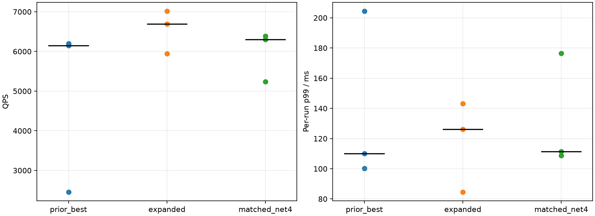
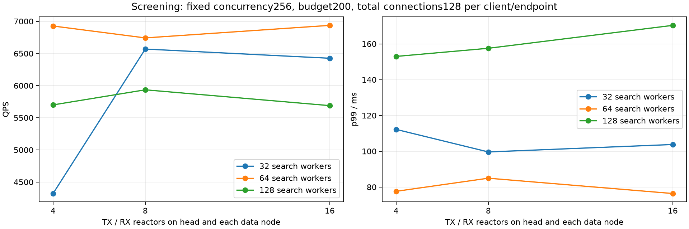

# 搜索与网络线程同步扩容实验

完成19轮、280000次正式查询。应用源码4093380及各机编译扩展与上轮相同，核验见verification.json。

Intel-35顶层+数据0、Intel-32数据1、Intel-30数据2；全量seq_2M、2560维、top10、预算200、并发256、预热200次。相同2000条验证查询重复，主要命中页缓存。短测每组10000请求；选出搜索>32且网络>4的最好短测组合，与相同搜索线程的网络4组合、上轮最高中位QPS配置各重复3轮，每轮20000请求。

网络数量N表示顶层和数据节点各逻辑发送客户端有N个发送事件循环、接收服务器有N个接收循环。每接收循环另有4个请求/报告handler，数据节点还各有1个管理handler（顶层没有该管理handler）；不能将N理解为进程全部网路线程数。所有循环固定min=max，连接总上限固定128/逻辑客户端/目标，接收handler总队列额度4096，路由16、合并4。网络线程数与handler数同步增加，无法单独归因其中一个。

## 三轮确认

|配置|搜索|数据TX/RX|顶层TX/RX|QPS中位数|QPS范围|各轮p99中位数ms|
|---|---:|---|---|---:|---|---:|
|prior_best|32|1/4|4/4|6145.26|2458.35–6195.54|110.14|
|expanded|64|16/16|16/16|6688.88|5947.46–7012.16|126.27|
|matched_net4|64|4/4|4/4|6300.61|5238.57–6382.07|111.42|

相同搜索线程下，扩大的网络布局相对网络4的QPS中位数变化为+6.16%。三轮范围与p99应同时比较，不能用单轮最高点证明稳定收益。

## 短测矩阵与完整记录

|轮次|搜索|数据TX/RX|顶层TX/RX|QPS|p99 ms|Recall@10|网络计数完整|
|---|---:|---|---|---:|---:|---:|---|
|prior_best_screen|32|1/4|4/4|6702.89|113.56|0.97030|True|
|screen_s32_net16|32|16/16|16/16|6425.60|103.77|0.97023|True|
|screen_s64_net16|64|16/16|16/16|6937.07|76.40|0.97025|True|
|screen_s32_net8|32|8/8|8/8|6568.77|99.62|0.97029|True|
|screen_s128_net8|128|8/8|8/8|5934.70|157.52|0.97024|True|
|screen_s64_net4|64|4/4|4/4|6927.11|77.63|0.97025|True|
|screen_s32_net4|32|4/4|4/4|4321.82|112.21|0.97025|True|
|screen_s64_net8|64|8/8|8/8|6742.07|84.95|0.97017|True|
|screen_s128_net4|128|4/4|4/4|5700.13|152.97|0.97014|True|
|screen_s128_net16|128|16/16|16/16|5688.87|170.32|0.97012|True|
|confirm_r0_prior_best|32|1/4|4/4|6145.26|100.31|0.97040|True|
|confirm_r0_expanded|64|16/16|16/16|5947.46|143.22|0.97027|True|
|confirm_r0_matched_net4|64|4/4|4/4|6382.07|108.64|0.97025|True|
|confirm_r1_matched_net4|64|4/4|4/4|6300.61|111.42|0.97024|True|
|confirm_r1_expanded|64|16/16|16/16|6688.88|126.27|0.97027|True|
|confirm_r1_prior_best|32|1/4|4/4|6195.54|110.14|0.97035|True|
|confirm_r2_prior_best|32|1/4|4/4|2458.35|204.33|0.97025|True|
|confirm_r2_expanded|64|16/16|16/16|7012.16|84.64|0.97030|True|
|confirm_r2_matched_net4|64|4/4|4/4|5238.57|176.50|0.97019|True|

## 确认轮次各阶段耗时

以下为每分支平均墙钟ms，分支跨节点/并行且控制路径与搜索可重叠，不可直接相加成查询延迟。状态锁等待是接纳时间的子区间；接收排队/校验未进一步分离。完整每节点均值、p99与样本数见各case/timings.json。

|轮次|接收排队/校验|接纳注册|其中接纳状态锁等待|计算就绪|搜索循环|完成命令队列|完成至报告发布|结果发送队列|
|---|---:|---:|---:|---:|---:|---:|---:|---:|
|confirm_r0_prior_best|9.381|2.775|2.527|6.626|7.852|1.242|0.008|0.147|
|confirm_r0_expanded|6.653|8.840|8.576|1.218|9.295|2.864|0.008|0.027|
|confirm_r0_matched_net4|10.684|2.766|2.528|1.247|8.912|2.938|0.008|0.072|
|confirm_r1_matched_net4|9.498|2.946|2.699|1.670|9.090|2.986|0.008|0.116|
|confirm_r1_expanded|3.929|8.251|7.998|1.552|8.904|3.236|0.008|0.021|
|confirm_r1_prior_best|10.512|2.695|2.452|4.671|7.597|1.160|0.008|0.154|
|confirm_r2_prior_best|1.044|1.649|1.369|1.844|12.120|0.635|0.013|0.074|
|confirm_r2_expanded|3.607|8.170|7.919|1.465|8.823|3.308|0.008|0.024|
|confirm_r2_matched_net4|16.991|3.534|3.252|0.587|9.757|2.777|0.009|0.157|

## 实际线程与其他指标

|轮次|数据进程线程0/1/2|顶层线程|数据平均CPU核0/1/2|协议字节/query|RPC/query|逻辑读取字节/query|物理读字节/快照窗口|
|---|---|---:|---|---:|---:|---:|---:|
|confirm_r0_prior_best|65/65/65|54|15.42/15.47/8.84|31976|3.05|2457600|0|
|confirm_r0_expanded|199/199/199|138|17.69/18.04/9.71|31974|3.06|2457600|356352|
|confirm_r0_matched_net4|103/103/103|54|17.74/19.07/9.95|31977|3.06|2457600|0|
|confirm_r1_matched_net4|103/103/103|54|18.06/17.00/9.30|31971|3.05|2457600|0|
|confirm_r1_expanded|199/199/199|138|17.57/17.95/10.06|31980|3.06|2457600|36864|
|confirm_r1_prior_best|65/65/65|54|13.97/14.50/8.47|32000|3.05|2457600|73728|
|confirm_r2_prior_best|65/65/65|54|17.29/9.48/4.73|31969|3.06|2457600|3338240|
|confirm_r2_expanded|199/199/199|138|18.18/17.28/10.11|31975|3.06|2457600|122880|
|confirm_r2_matched_net4|103/103/103|54|14.26/16.72/11.68|32038|3.07|2457600|1024000|

CPU与物理读量来自进程快照窗口，不能等同精确查询测量窗口；逻辑读取不等于SSD物理读取。完整精确距离、RaBitQ、展开数、深度、CPU、阶段均值、逐query延迟与召回保留于result.json及runs。服务延迟不含等待并发额度的客户端backlog，后者另存。

## 跨节点p99附近真实查询

选择expanded组QPS最接近三轮中位数的confirm_r1_expanded，在跨节点请求中选最接近本轮全体p99的样本。各主机时钟独立，不直接相减。

## 限制与复现

固定并发256检验的是同负载下网络线程扩容。没有同时提高连接额度或并发，不能排除更高到达率下需要更多网络资源。顶层与数据网络同时调整，短测矩阵不能单独归因某一侧；并未修改接纳锁或GIL路径。短测和确认轮次仍只持续数秒，不能替代长时间稳态实验或冷SSD实验。所有请求与慢轮次保留，网络计数不完整标记单列。

入口run_sweep.py，参数sweep.yaml，结果progress.json/comparison.json，各轮有效配置保留在case目录。未自动改变生产默认值。

## 扩容收益与等待位置

同为每节点64搜索线程，网络4→16的三轮QPS中位数变化+6.16%（6300.61→6688.88），各轮p99中位数变化+13.32%（111.42→126.27ms）。三轮QPS范围分别5238.57–6382.07与5947.46–7012.16，存在重叠，尚不能证明稳定或统计显著收益。之前32搜索线程配置本轮另有一次2458QPS慢轮，完整保留。

因此，“扩大搜索线程后，更多网络处理能力可能有益”有一定实验支持；“网络数量必须与搜索线程等比例增长”没有得到证明。128搜索线程、16循环的短测未优于128搜索线程、4循环。

下表为三轮各自的每分支均值再取中位数，单位ms；锁等待是接纳注册的子区间，不重复相加。

|阶段|64搜索/网络4|64搜索/网络16|
|---|---:|---:|
|接收排队及校验|10.684|3.929|
|接纳与注册|2.946|8.251|
|其中接纳状态锁等待|2.699|7.998|
|计算队列及设置|1.247|1.465|
|搜索循环|9.090|8.904|
|完成命令队列|2.938|3.236|
|结果发送队列|0.116|0.024|

接收等待降低的同时，接纳状态锁等待升高，说明等待仍受共享状态影响，不能仅依据搜索池大小给网络池设置固定比例。锁获取的墙钟等待也包含线程被调度恢复的时间，不能全当成锁持有者的CPU耗时。

实际数据进程线程数从103增至199，顶层从54增至138。扩容布局角色比例：数据“搜索:请求handler:接收reactor:派发TX:报告TX:控制”为64:64:16:16:16:1，另含16个管理handler和监测/辅助线程；顶层“路由:合并:报告handler:接收reactor:入口TX:租约TX”为16:4:64:16:16:16。

p99跨节点样本query_id=146842、job=18145延迟126.264ms。父节点Intel-35在9.629ms释放搜索线程并独立发报告；子节点Intel-32接收等待73.754ms、接纳26.104ms（其中状态锁等待25.312ms）、搜索12.445ms。父节点跨机派发至ACK的100.121ms与子节点接纳前长等待相符，不能将它整体解释为网络传输时间。

所有19轮共280000查询均成功，Recall@10约97.03%，网络计数完整性标记均为true，内存暂存无溢出。三机实验端口已关闭。配置另存expanded_layout.yaml、expanded_data_plan.yaml、expanded_head_plan.yaml，生产默认值未修改。

后续自适应策略应将接收排队与接纳锁等待共同作为反馈：排队高且共享状态等待低时试探增加handler/循环；若锁等待上升、QPS无稳定收益或p99恶化，则回退。这里是基于本轮结果的设计建议，尚未实现自动按锁等待调节的策略。
