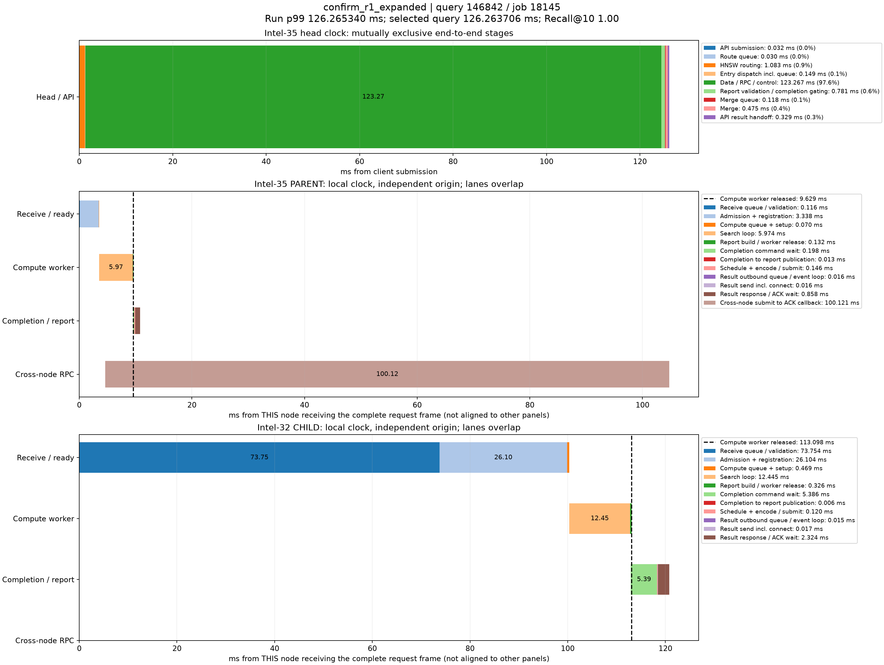

# p99真实查询时序分解

来源：confirm_r1_expanded，20000条查询。在跨节点查询中选择最接近本轮全体查询p99的记录；这不是跨节点子集的p99。

本轮p99为126.265340220ms；query_id=146842、job=18145，延迟126.263706000ms，相差0.001634220ms，Recall@10=1.00。

顶层面板使用同一主机时钟，阶段互斥且总和等于端到端服务延迟。每个数据节点单独以收到完整报文为零点，不能跨主机直接对齐时间轴或相加。节点内计算、控制、派发存在重叠；虚线表示计算线程释放时刻，之后的控制/网络等待不占用该计算线程。结果ACK时刻与用户Future完成时刻也不同。

|顶层阶段|耗时ms|占服务延迟|
|---|---:|---:|
|API submission|0.031691|0.03%|
|Route queue|0.030325|0.02%|
|HNSW routing|1.083080|0.86%|
|Entry dispatch incl. queue|0.148816|0.12%|
|Data / RPC / control|123.266751|97.63%|
|Report validation / completion gating|0.780568|0.62%|
|Merge queue|0.118480|0.09%|
|Merge|0.475421|0.38%|
|API result handoff|0.328574|0.26%|

## Intel-35 / PARENT

|阶段|本节点相对起点ms|耗时ms|
|---|---:|---:|
|Receive queue / validation|0.000000|0.115565|
|Admission + registration|0.115565|3.337952|
|Compute queue + setup|3.453517|0.069817|
|Search loop|3.523334|5.974104|
|Report build / worker release|9.497438|0.131955|
|Completion command wait|9.566508|0.198053|
|Completion to report publication|9.764561|0.013303|
|Schedule + encode / submit|9.777864|0.145932|
|Result outbound queue / event loop|9.923796|0.016107|
|Result send incl. connect|9.939903|0.016116|
|Result response / ACK wait|9.956019|0.858387|
|Cross-node submit to ACK callback|4.625163|100.121387|

## Intel-32 / CHILD

|阶段|本节点相对起点ms|耗时ms|
|---|---:|---:|
|Receive queue / validation|0.000000|73.753687|
|Admission + registration|73.753687|26.104106|
|Compute queue + setup|99.857793|0.469253|
|Search loop|100.327046|12.445079|
|Report build / worker release|112.772125|0.325745|
|Completion command wait|112.913476|5.386060|
|Completion to report publication|118.299536|0.006384|
|Schedule + encode / submit|118.305920|0.120382|
|Result outbound queue / event loop|118.426302|0.014792|
|Result send incl. connect|118.441094|0.017024|
|Result response / ACK wait|118.458118|2.324393|

结果RPC排队起点由 sender_enter_ns - round(pool_wait_ms * 1e6) 还原；pool_wait_ms来自底层同一主机时钟的queued_ns与send_start_ns之差。旧message_ready_ns是在异步提交成功后记录，网络线程可能已开始发送，不能用它直接计算发送前队列。还原数值保存在stages.json/CSV，未改写原始时间戳。

接收队列/验证、完成控制和发送前等待均为观测区间，可能包含OS调度及状态锁等待，不能据图将其全部认定为锁、CPU计算或纯链路传输。单条p99附近查询用于定位现象，不代表所有尾延迟样本。selected.json保留完整源记录，stages.json/CSV保存精确阶段数值。
