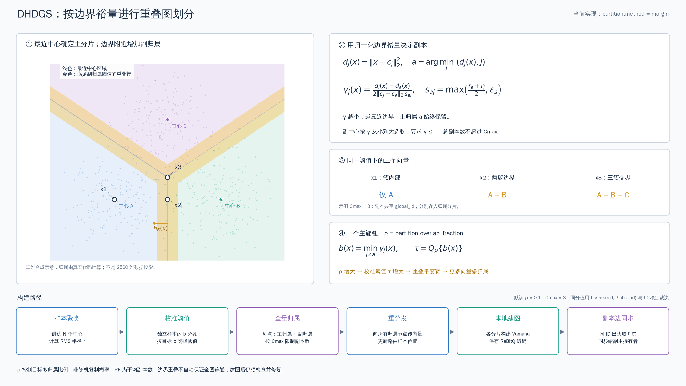

# 当前重叠图划分算法示意



[SVG 矢量图](partition_16x9.svg)。PNG 为 3200×1800、16:9；使用现有 `python/dhdgs/partition.py` 的 `Model.scores`、`calibrate`、`memberships` 计算，未修改算法或服务配置。

图中是二维 L2 合成示例，用于解释规则，不是 seq_2M 的投影，也不是性能测试结果。手工设置三个中心，并从合成校准样本计算各主簇 RMS 半径；实际构建中中心由样本 K-means 训练。向量/中心距离使用原始精确距离，划分公式不使用 RaBitQ 近似值。cosine 模式先按实现进行向量归一化，再在相应空间计算。

## 从图中读出算法

1. 浅蓝、浅绿、浅紫表示最近中心对应的主归属区域。主归属始终保留。
2. 金色区域表示至少一个副中心通过阈值，可以在多个分片保存同一 global_id 的向量。
3. `h_j` 是向量到主中心与候选中心等距超平面的垂直距离；除以两个簇 RMS 半径的平均值，得到无量纲分数 `gamma_j`。`epsilon_s` 防止退化除零。
4. 在独立校准样本上，取每个向量最小的副中心分数 `b`，由目标多归属比例 `rho` 确定截断阈值。代码按 `(b, hash(seed, global_id), global_id)` 稳定排序，选第 `floor(rho * 样本数)` 个位置；图中的分位数符号是该次序统计量的简写，不是 NumPy 线性插值分位数。
5. 对每个向量保留主中心，再按 `(gamma_j, 中心ID)` 选通过阈值的副中心，最多保留 `max_copies` 份。阈值处并列分数采用稳定 hash/ID 裁决，不能只用无条件 `gamma <= tau` 替代完整代码。

图中 `rho=0.1`、`max_copies=3`，阈值约 0.302119；x1 仅归属 A，x2 归属 A/B，x3 归属 A/B/C。x3 在数学上三中心等距，浮点计算存在约 1e-16 的差异；不影响示例多归属集合。

`rho=0` 特判为唯一主归属；`rho=1` 且至少两个分片、`max_copies>=2` 时每点至少双归属。`max_copies=1` 时不产生任何副本。中心和尺度固定时，增大 rho 使阈值及归属集合单调扩大；rho 不是在线跨服务器扩展概率，也不是平均副本因子 RF。实际全量多归属比例应单独测量，校准样本不保证全量比例完全相等。

下方流程说明归属如何转化为图分片：重分发至所有归属节点，更新路由样本位置，各分片建图，再对共享顶点同步出边并集。共享顶点的出边只同步给其副本持有者。全局连通性仍需建图后单独验证、必要时修复，并重新同步最终邻接表；不能仅靠金色重叠带证明连通或召回率。

## 复现

在 DHDGS 目录运行：

```sh
.venv/bin/python test/partition_illustration_20261021/draw_partition.py
```

`illustration_data.json` 保存中心、半径、阈值、示例归属和合成样本 rho 扫描结果。脚本会校验三个示例分别具有 1、2、3 个归属。
