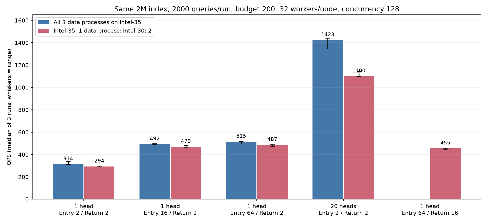
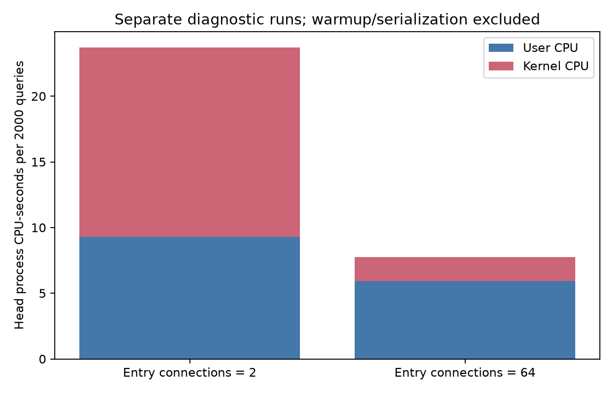
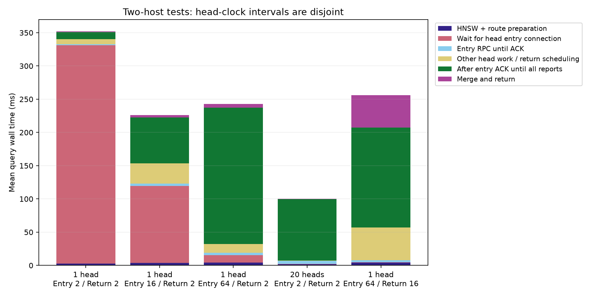

# 为什么当前两机QPS明显低于旧单机：受控实验报告

**主要损失出在入口与控制面布局变化。** 旧单机高吞吐测试用了20个独立入口进程，现在是一个持久head、每目标2条入口连接。把新架构搬回单机也只有约314 QPS，搬到两机约294 QPS；在同一两机数据部署上恢复20入口实验布局，则达到约1100 QPS。多机确有额外损耗，但不能把之前约1400→287的整个下降归给网络。

本轮只改变实验进程和实验配置，正式集群继续保持Intel-35 head/data-0、Intel-30 data-1/data-2，每节点32工作线程、默认客户端并发128、预算200。多入口仅为解释历史基准的诊断，不是已替换为生产部署。

## 1. 实验控制与验收

全部固定完整2M×2560D索引、L2、top-k10、预算200、remote_weight=1、相同2000条validation查询、总客户端并发128、每数据节点32查询工作线程、native搜索/native控制及buffered sync_pread。

- 主矩阵：单机/两机 × head入口每目标2/16/64条连接 × 3轮，共36000查询。
- 补充入口布局：单机/两机各3轮20入口进程（8进程×7客户端线程 + 12进程×6客户端线程，总并发仍128），共12000查询。
- 补充回传：两机、单head、入口64条，仅原生完成报告连接由2增至16，3轮共6000查询。数据间分支派发连接仍2。
- CPU剖析：入口2/64各一轮2000查询，共4000条，单列展示。

**正式性能实验54000条，0失败；所有组平均Recall@10为96.955%–97.065%。预算、指标完整、无节点重访、无head候选扩展审计均通过。** 各节点正式查询窗口物理存储读增量均为0，属于热OS页缓存结果，不是冷SSD能力测试。

所有负载实验串行执行。新单head对照使用相同持久Engine/benchmark实现，并复现了当前约287 QPS的量级。主矩阵交替拓扑和容量顺序；每组3次重复，表格取QPS与单轮p99各自的中位数。更详细的步骤与干预边界见 [PLAN.md](PLAN.md)。

## 2. 同条件结果

“单机”表示3个独立数据进程都在Intel-35；“两机”表示Intel-35一个、Intel-30两个。head都在Intel-35。入口/回传容量按**每目标、每入口进程**计。

| 入口进程数 | 入口连接 / 回传连接 | 单机QPS | 两机QPS | 单机p99 | 两机p99 |
|---:|---:|---:|---:|---:|---:|
| 1 | 2 / 2（当前基线） | 313.57 | 293.53 | 2769.12 ms | 3173.43 ms |
| 1 | 16 / 2 | 491.83 | 469.55 | 1742.00 ms | 1608.98 ms |
| 1 | 64 / 2 | 515.36 | 486.63 | 460.68 ms | 513.12 ms |
| 20 | 每进程2 / 每回调端点2 | 1422.72 | 1099.73 | 185.27 ms | 244.91 ms |
| 1 | 64 / 16 | 未测 | 455.22 | 未测 | 1171.07 ms |

每组完整范围与原始中位数在 [group_summary.json](group_summary.json)。图中误差线为3轮最小/最大值，不是置信区间。单head主矩阵下两机比单机低约4.5%–6.4%；20入口布局下低约22.7%。物理损耗会随瓶颈位置和负载发生器变化，不能用一个百分比概括所有工作点。

20个入口进程还将每目标的入口连接总容量从2增加到40，并增加独立GIL、回调端点及处理线程。因此该实验确认了**入口布局的影响**，并未将增益单独归因于GIL。

## 3. 首要瓶颈：顶层入口连接的等待和调度

上轮正式测试的2000查询中，入口 `pool_wait_ms` 平均339.86ms，占查询延迟总和的91.43%。最慢query 836095仅访问Intel-35本地data-0，没有跨节点分支：

| 阶段 | 耗时 |
|---|---:|
| 客户端提交到返回 | 4723.50 ms |
| 获取顶层入口连接 | 4678.09 ms |
| 获取连接后的入口RPC剩余时间 | 2.10 ms |
| 数据节点分支本地总执行 | 9.77 ms |

这些阶段存在包含/重叠关系，不能将表中所有数字直接相加。完整原始query在 [prior_evidence.json](prior_evidence.json)。

新实验再次复现：两机入口2条时，平均连接等待328.37ms；入口64条时降至11.18ms，QPS中位数从293.53升至486.63（约+65.8%）。该干预只改变实验head的入口池；数据节点计算预算、线程以及分支/回传连接均保持不变。

入口池实现中，一个进程共享一个Condition，释放连接调用 `notify_all()`；等待不同目标连接的线程会一起被唤醒再竞争。同一时间每目标最多2条入口RPC持有连接，直到收到接纳ACK；三个目标合计最多6条在途入口提交RPC。**这不等于只能有6条查询在计算**，ACK后连接会释放。

`pool_wait_ms`覆盖连接池锁/条件变量、被唤醒后的调度和连接健康检查，不能解释成“某把锁被单线程持有了几秒”。Condition等待会睡眠；问题更接近过多唤醒、竞争和不公平等待，而不是每个线程执行一个忙轮询循环。

另做的CPU剖析支持这条判断：

| 固定2000查询的顶层CPU | 入口2条 | 入口64条 |
|---|---:|---:|
| 用户态CPU秒 | 9.29 | 5.94 |
| 内核态CPU秒 | 14.43 | 1.81 |
| 总CPU秒 | 23.72 | 7.75 |
| 近似查询测量窗口 | 6.92 s | 4.38 s |

CPU秒可因多线程并行而大于墙钟秒。插桩窗口包含工作线程启动与最后排空，排除预热和结果序列化；不与未插桩三轮性能数据混合。内核态CPU减少约87.5%，与入口唤醒/调度竞争减轻一致；本轮没有使用内核调度事件追踪将这些系统CPU进一步精确分摊。

## 4. 扩大入口后：等待转移到完成报告路径

单head、两机的平均时间分解如下：

图中使用head同一时钟上的互斥区间，未跨主机相减；“入口ACK后等所有报告”包含数据计算、分支依赖、结果发送排队与head接收处理，不能全部称为网络时间。

入口2→64条后，该ACK后区间由平均10.38ms升至205.30ms；原生计算切片累计仍约10.7–10.9ms。针对完成报告的节点内时间戳可进一步看到：

| 单head、入口64条 | 原生回传2条 | 原生回传16条 |
|---|---:|---:|
| data-0 回传连接等待均值 | 184.12 ms | 77.79 ms |
| data-1 回传连接等待均值 | 163.92 ms | 33.25 ms |
| data-0 发出报告到收到ACK均值 | 7.27 ms | 51.94 ms |
| data-1 发出报告到收到ACK均值 | 7.24 ms | 52.00 ms |
| 两机QPS中位数 | 486.63 | 455.22 |

因此，“看到回传池排队→继续加连接”不是有效的完整方案。连接增加减少了部分池内等待，却增加了RPC发出后的等待，并未提高吞吐。这一RPC区间也包含head解析、状态更新、ACK及调度，不能当作纯网络RTT。结合同一两机部署采用20个独立入口进程可达到约1100 QPS，证据指向**单head Python入口/完成处理及共享调度路径的容量限制**。

本轮没有将GIL、Python业务处理、操作系统调度和TCP行为各自的份额全部独立量化。不能宣称“所有剩余等待都是GIL”，也不能根据某一个阶段变短就认定端到端优化成功。

## 5. 真正的两机额外损耗：硬件/运行时与节点接纳队列

20入口对照下，单机1422.72、两机1099.73 QPS，差约22.7%。此时入口池等待已很小，但节点接纳队列更加突出：

| 累计工作时长，跨分支求和后按query平均 | 单机20入口 | 两机20入口 |
|---|---:|---:|
| 数据节点接纳队列等待 | 52.54 ms | 73.98 ms |
| 原生计算切片 | 10.92 ms | 11.74 ms |

同一分片按扩展工作量归一后：data-1每100次扩展约5.85→7.54ms，data-2约4.29→5.34ms。扩展次数与召回基本一致，查询核心计算成本在Intel-30上更高。

两机环境并不相同：

| 主机 | CPU | 物理核 / 逻辑CPU | Python |
|---|---|---:|---|
| Intel-35 | Xeon Gold 6448H，4插槽 | 128 / 256 | 3.12.3 |
| Intel-30 | Xeon Platinum 8358P，2插槽 | 64 / 128 | 3.10.12 |

Intel-30的两个数据进程共享该机资源。以上成本差同时包含CPU代际、NUMA/内存分布、Python版本和同机资源共享，**本轮未将它们逐项分离**，所以不能把22.7%全部命名为“网络开销”。下一轮若需要量化这些因素，应统一Python版本并固定CPU/NUMA，再做同分片和同入口负载对照。

空闲数据网走IPoIB，30次ping平均0.108ms、最大0.219ms、0丢包，见 [ping.log](ping.log)。这只说明空闲ICMP传播时延很小，不替代负载下TCP/带宽测量；它与秒级等待发生在软件队列的时间戳证据一致。

## 6. 建议的优化顺序

1. **先改head入口连接的排队方式。** 按目标独立排队、定向唤醒和公平分配，减少全局notify_all的唤醒竞争；将head入口、数据间派发、完成报告连接参数拆开。入口64条已经改善吞吐和p99，但不是已证明的全局最优值。
2. **接着提高单head处理完成报告的能力。** 优先评估C++/原生事件循环处理消息解码、生命周期更新、结果合并和ACK，以及有界异步入口。保留一个逻辑HNSW入口，不让head参与候选扩展。数据查询仍按每分支一个计算线程执行；无需改变远端扩展决定函数。
3. **最后处理真实的节点差异。** 在统一运行时、CPU/NUMA绑定后测Intel-30接纳与计算路径，再决定线程、队列和跨节点策略。减少入口内部等待时仍应显式报告上游积压，不能用降低并发冒充同负载提速。

本轮为诊断实验，没有将实验连接容量或原生控制器启动覆盖应用到正式服务。原生产节点PID、32线程与预算200已复核；默认并发128保留。临时本机与跨机节点、20入口进程均已结束，清理记录归档。

## 文件入口

- [实验设计](PLAN.md)、[主矩阵YAML](experiment.yaml)
- [组间汇总](group_summary.json)、[逐轮CSV](comparison.csv)、[正式查询审计](audit.json)
- `cases/`：单head各组的原始逐query、节点快照、时间分解与CPU剖析
- `legacy20/`、`legacy20local/`：两机/单机20入口对照，包括每个入口的PID、退出状态、原始查询
- [硬件环境](hardware.json)、[最终生产状态](production_final.json)
- `local_cleanup.json`、`legacy20local/cleanup.json`、`control16/cleanup.json`：临时节点清理
