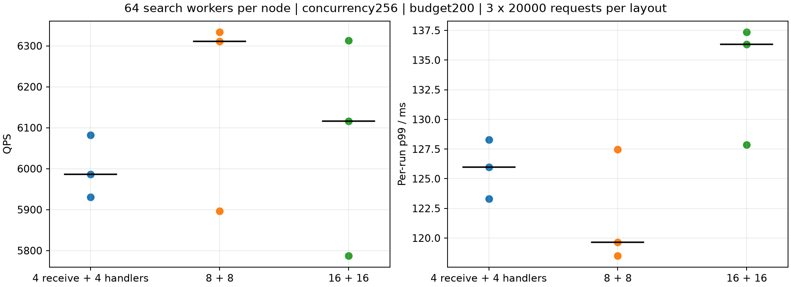
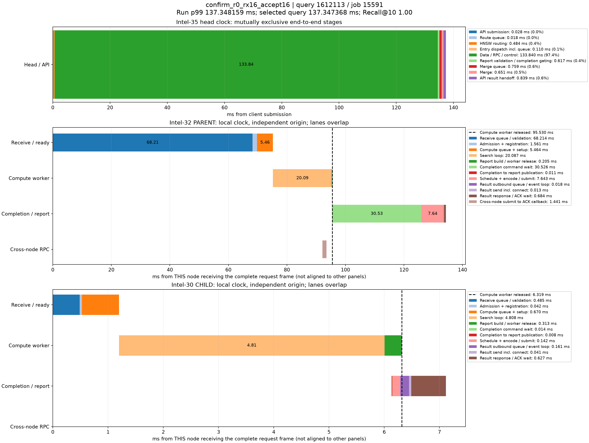

# 接收线程与接纳线程一对一配置对比

共9轮、180000次正式查询。用户确认的含义为每数据节点总接收循环/总查询请求handler数量：4/4、8/8、16/16。每个接收循环仅配1个查询handler。

## 实验条件与计数口径

Intel-35顶层+数据0，Intel-32数据1，Intel-30数据2；全量seq_2M索引、2560维、top10、预算200、并发256，每数据节点64搜索线程。每轮预热200次，再运行20000请求，每组3轮。三轮顺序分别4→8→16、8→16→4、16→4→8。相同2000条查询重复，热缓存为主，应用源码4093380及各机编译扩展哈希固定。

本轮只改变数据节点接收循环数量，handler固定每循环1。数据派发与报告客户端各4个发送循环；顶层固定路由16、合并4、接收循环4、每循环4个报告handler、入口/租约客户端各4个发送循环。TCP连接总额度固定128/逻辑发送客户端/目标，接收handler总队列容量4096、最大接收连接4096。连接额度不是接收线程数，也不代表实际总有128条活跃连接。

“接纳线程”指native server的查询请求handler，承担请求解码、操作分派和接纳等，仍共享原有Python GIL和查询状态锁；没有将其改造成独立无锁接纳器。每个数据接收循环还各有1个管理handler，另计，不属于查询接纳线程。发送、控制、管理与监测等线程存在，因此4+4不是进程全部线程数。

## 三轮结果

|接收+接纳|QPS中位数|QPS范围|各轮p99中位数ms|p99范围ms|合并请求/时长QPS|
|---|---:|---|---:|---|---:|
|4+4|5985.98|5930.26–6082.24|125.97|123.31–128.30|5998.84|
|8+8|6310.68|5896.29–6333.28|119.63|118.50–127.49|6173.40|
|16+16|6116.31|5787.09–6313.37|136.33|127.85–137.35|6064.41|

最高QPS中位数为rx8_accept8，最低各轮p99中位数为rx8_accept8。三轮存在波动，不将测得的最高值称为全局最优或统计显著优势。各轮p99中位数不是汇总全部请求后的p99。

## 阶段均值对比

单位ms，为各轮每分支均值再取中位数。锁等待是接纳注册的子区间；分支与控制路径可能重叠，不能相加成每query延迟。各节点只在自己的单调时钟内计算时差。

|阶段|4+4|8+8|16+16|
|---|---:|---:|---:|
|接收排队及校验|14.561|11.114|10.443|
|接纳与注册|0.766|1.461|2.624|
|其中接纳状态锁等待|0.527|1.216|2.377|
|计算队列及设置|0.881|1.464|1.289|
|搜索循环|9.019|9.164|9.182|
|报告构造及搜索线程释放|0.276|0.275|0.276|
|完成命令队列|2.702|3.228|2.847|
|完成至报告发布|0.008|0.008|0.008|
|结果发送队列|0.031|0.251|0.036|

每节点完整阶段均值、p99与样本数保留于各case/timings.json，阶段组间比较另见phase_comparison.json。

## 逐轮性能与资源

|轮次|QPS|p99 ms|Recall@10|数据进程线程0/1/2|顶层线程|网络计数完整|
|---|---:|---:|---:|---|---:|---|
|confirm_r0_rx4_accept4|5930.26|128.30|0.97030|91/91/91|54|True|
|confirm_r0_rx8_accept8|5896.29|127.49|0.97025|103/103/103|54|True|
|confirm_r0_rx16_accept16|6116.31|137.35|0.97026|127/127/127|54|True|
|confirm_r1_rx8_accept8|6310.68|119.63|0.97034|103/103/103|54|True|
|confirm_r1_rx16_accept16|6313.37|127.85|0.97031|127/127/127|54|True|
|confirm_r1_rx4_accept4|6082.24|125.97|0.97024|91/91/91|54|True|
|confirm_r2_rx16_accept16|5787.09|136.33|0.97030|127/127/127|54|True|
|confirm_r2_rx4_accept4|5985.98|123.31|0.97040|91/91/91|54|True|
|confirm_r2_rx8_accept8|6333.28|118.50|0.97025|103/103/103|54|True|

|轮次|平均CPU核0/1/2|协议字节/query|RPC/query|pread ms/query|精确距离 ms/query|RaBitQ ms/query|展开顶点数/query|跨节点深度|物理读取字节/快照窗口|
|---|---|---:|---:|---:|---:|---:|---:|---:|---:|
|confirm_r0_rx4_accept4|16.77/18.44/9.32|31975.145|3.056|1.169|2.196|4.187|200.000|0.351|0|
|confirm_r0_rx8_accept8|15.84/18.10/9.21|31987.908|3.058|1.104|2.189|4.327|200.000|0.351|147456|
|confirm_r0_rx16_accept16|17.92/17.98/9.60|31976.376|3.056|1.442|2.203|4.133|200.000|0.351|208896|
|confirm_r1_rx8_accept8|17.91/17.75/9.81|31974.469|3.056|1.223|2.197|4.134|200.000|0.351|73728|
|confirm_r1_rx16_accept16|16.60/17.80/9.83|31982.243|3.056|1.168|2.209|3.891|200.000|0.351|98304|
|confirm_r1_rx4_accept4|16.23/18.11/9.61|31973.937|3.055|1.111|2.196|4.122|200.000|0.350|610304|
|confirm_r2_rx16_accept16|18.62/17.75/9.09|31974.864|3.056|1.496|2.236|4.415|200.000|0.351|159744|
|confirm_r2_rx4_accept4|18.96/17.65/9.27|31991.582|3.059|1.598|2.216|4.287|200.000|0.352|319488|
|confirm_r2_rx8_accept8|18.67/17.22/9.53|31987.120|3.058|1.256|2.223|4.281|200.000|0.351|110592|

CPU与物理读量来自进程快照窗口，包含测量窗口以外的快照开销；pread含页缓存命中，不等于物理SSD读取时间。其余逐query统计、跳数/深度、逻辑读量与线程CPU等保留在result.json及runs中。服务延迟不包含等待并发额度的客户端backlog，后者单独记录。

## 各组跨节点p99附近样本

各组先选QPS最接近本组三轮中位数的一轮，再在跨节点请求中选最接近该轮全体p99的查询；这不是跨节点子集的p99。数据节点独立时钟面板不能直接对齐或相加。

rx4_accept4：confirm_r2_rx4_accept4

rx8_accept8：confirm_r1_rx8_accept8

rx16_accept16：confirm_r0_rx16_accept16

## 复现与限制

参数集中在sweep.yaml；run_sweep.py顺序执行三机测试，analyze.py在全部测量结束后处理记录。每轮完整保留结果，不删除慢查询或慢轮次；网络计数完整性单独标记。结果先保存在内存，测量后持久化；原始记录压缩前后进行SHA256校验。

每组仅三轮，每轮数秒，不能替代长时间稳态负载、更多独立查询或冷SSD实验。管理线程也随接收循环数增加，这是当前实现结构的组成部分。没有改变锁或GIL路径，不能用线程数量变化单独证明任何一把锁的因果作用。

最高吞吐与最低p99配置分别保存为best_qps_*及best_p99_* YAML，生产默认值未修改。

## 本轮选择及剩余等待

按此前“优先最低p99，再比较QPS”的偏好，本轮保留8+8作为后续验证候选：相对4+4，QPS中位数增加5.42%，各轮p99中位数降低5.03%；它同时优于16+16的本轮中位QPS和p99。但三轮QPS范围重叠，每轮仅数秒，不能称为已经证明的长期稳定最优配置。

4+4→8+8，接收排队及校验的每分支均值中位数14.561→11.114ms，接纳状态锁等待0.527→1.216ms。8+8→16+16，接收等待仅继续降至10.443ms，接纳状态锁等待却升至2.377ms；搜索循环保持约9ms。此结果支持控制接收并发与共享状态竞争之间的平衡，不支持单纯将接收/接纳线程加到最大。锁等待是接纳总时间的子区间，不能重复相加，锁获取墙钟等待也包含线程恢复调度时间。

8+8代表轮次的跨节点p99附近样本为query_id=1082402、job=19051，延迟119.628068ms、Recall@10=1.00。Intel-35父分支在6.401ms释放计算线程；Intel-32子分支接收排队及校验97.773ms、接纳1.026ms、计算队列及设置3.358ms、搜索7.925ms、完成命令队列4.929ms。父跨机提交至ACK耗时99.112ms不代表父计算线程等待99ms；该线程已释放。接收阶段包含handler排队、解码、GIL获取和操作分派等，当前时间点不能将97.773ms全部归为网络传输或某一把锁。

全部180000请求成功，Recall@10约97.03%，各轮网络计数完整性审计通过，内存暂存无溢出。测试端口已在三台机器关闭。best_p99_layout.yaml与best_qps_layout.yaml本轮均为8+8，配套有效计划已保存，生产默认值未修改。
