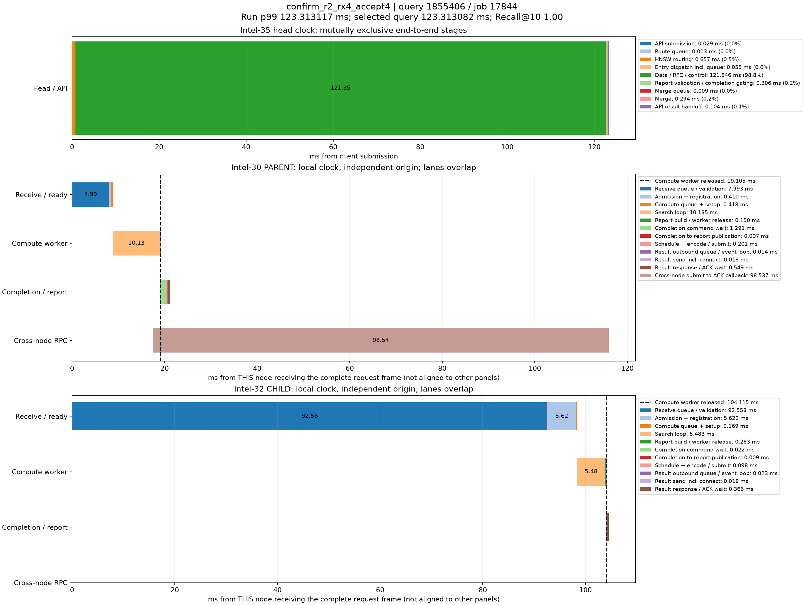

# p99真实查询时序分解

来源：confirm_r2_rx4_accept4，20000条查询。在跨节点查询中选择最接近本轮全体查询p99的记录；这不是跨节点子集的p99。

本轮p99为123.313116890ms；query_id=1855406、job=17844，延迟123.313082000ms，相差0.000034890ms，Recall@10=1.00。

顶层面板使用同一主机时钟，阶段互斥且总和等于端到端服务延迟。每个数据节点单独以收到完整报文为零点，不能跨主机直接对齐时间轴或相加。节点内计算、控制、派发存在重叠；虚线表示计算线程释放时刻，之后的控制/网络等待不占用该计算线程。结果ACK时刻与用户Future完成时刻也不同。

|顶层阶段|耗时ms|占服务延迟|
|---|---:|---:|
|API submission|0.028997|0.02%|
|Route queue|0.013042|0.01%|
|HNSW routing|0.657479|0.53%|
|Entry dispatch incl. queue|0.054715|0.04%|
|Data / RPC / control|121.846052|98.81%|
|Report validation / completion gating|0.305583|0.25%|
|Merge queue|0.009281|0.01%|
|Merge|0.293874|0.24%|
|API result handoff|0.104059|0.08%|

## Intel-30 / PARENT

|阶段|本节点相对起点ms|耗时ms|
|---|---:|---:|
|Receive queue / validation|0.000000|7.992829|
|Admission + registration|7.992829|0.409984|
|Compute queue + setup|8.402813|0.418140|
|Search loop|8.820953|10.134825|
|Report build / worker release|18.955778|0.149630|
|Completion command wait|19.061592|1.290670|
|Completion to report publication|20.352262|0.006768|
|Schedule + encode / submit|20.359030|0.201413|
|Result outbound queue / event loop|20.560443|0.014420|
|Result send incl. connect|20.574863|0.017530|
|Result response / ACK wait|20.592393|0.549200|
|Cross-node submit to ACK callback|17.427044|98.537079|

## Intel-32 / CHILD

|阶段|本节点相对起点ms|耗时ms|
|---|---:|---:|
|Receive queue / validation|0.000000|92.558102|
|Admission + registration|92.558102|5.621996|
|Compute queue + setup|98.180098|0.169078|
|Search loop|98.349176|5.482779|
|Report build / worker release|103.831955|0.283253|
|Completion command wait|103.981150|0.022477|
|Completion to report publication|104.003627|0.008720|
|Schedule + encode / submit|104.012347|0.097505|
|Result outbound queue / event loop|104.109852|0.023213|
|Result send incl. connect|104.133065|0.017538|
|Result response / ACK wait|104.150603|0.365949|

结果RPC排队起点由 sender_enter_ns - round(pool_wait_ms * 1e6) 还原；pool_wait_ms来自底层同一主机时钟的queued_ns与send_start_ns之差。旧message_ready_ns是在异步提交成功后记录，网络线程可能已开始发送，不能用它直接计算发送前队列。还原数值保存在stages.json/CSV，未改写原始时间戳。

接收队列/验证、完成控制和发送前等待均为观测区间，可能包含OS调度及状态锁等待，不能据图将其全部认定为锁、CPU计算或纯链路传输。单条p99附近查询用于定位现象，不代表所有尾延迟样本。selected.json保留完整源记录，stages.json/CSV保存精确阶段数值。
