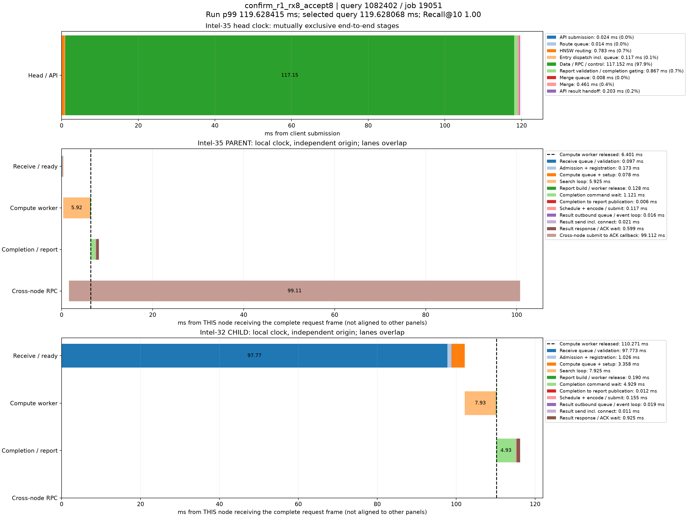

# p99真实查询时序分解

来源：confirm_r1_rx8_accept8，20000条查询。在跨节点查询中选择最接近本轮全体查询p99的记录；这不是跨节点子集的p99。

本轮p99为119.628414790ms；query_id=1082402、job=19051，延迟119.628068000ms，相差0.000346790ms，Recall@10=1.00。

顶层面板使用同一主机时钟，阶段互斥且总和等于端到端服务延迟。每个数据节点单独以收到完整报文为零点，不能跨主机直接对齐时间轴或相加。节点内计算、控制、派发存在重叠；虚线表示计算线程释放时刻，之后的控制/网络等待不占用该计算线程。结果ACK时刻与用户Future完成时刻也不同。

|顶层阶段|耗时ms|占服务延迟|
|---|---:|---:|
|API submission|0.023522|0.02%|
|Route queue|0.013565|0.01%|
|HNSW routing|0.783333|0.65%|
|Entry dispatch incl. queue|0.116762|0.10%|
|Data / RPC / control|117.152136|97.93%|
|Report validation / completion gating|0.866810|0.72%|
|Merge queue|0.007809|0.01%|
|Merge|0.461032|0.39%|
|API result handoff|0.203099|0.17%|

## Intel-35 / PARENT

|阶段|本节点相对起点ms|耗时ms|
|---|---:|---:|
|Receive queue / validation|0.000000|0.096898|
|Admission + registration|0.096898|0.172812|
|Compute queue + setup|0.269710|0.078379|
|Search loop|0.348089|5.924701|
|Report build / worker release|6.272790|0.128100|
|Completion command wait|6.340751|1.120625|
|Completion to report publication|7.461376|0.006357|
|Schedule + encode / submit|7.467733|0.116677|
|Result outbound queue / event loop|7.584410|0.015844|
|Result send incl. connect|7.600254|0.020958|
|Result response / ACK wait|7.621212|0.599330|
|Cross-node submit to ACK callback|1.640038|99.111891|

## Intel-32 / CHILD

|阶段|本节点相对起点ms|耗时ms|
|---|---:|---:|
|Receive queue / validation|0.000000|97.772840|
|Admission + registration|97.772840|1.026265|
|Compute queue + setup|98.799105|3.357582|
|Search loop|102.156687|7.925155|
|Report build / worker release|110.081842|0.189607|
|Completion command wait|110.157691|4.928615|
|Completion to report publication|115.086306|0.012347|
|Schedule + encode / submit|115.098653|0.155265|
|Result outbound queue / event loop|115.253918|0.018864|
|Result send incl. connect|115.272782|0.011347|
|Result response / ACK wait|115.284129|0.924710|

结果RPC排队起点由 sender_enter_ns - round(pool_wait_ms * 1e6) 还原；pool_wait_ms来自底层同一主机时钟的queued_ns与send_start_ns之差。旧message_ready_ns是在异步提交成功后记录，网络线程可能已开始发送，不能用它直接计算发送前队列。还原数值保存在stages.json/CSV，未改写原始时间戳。

接收队列/验证、完成控制和发送前等待均为观测区间，可能包含OS调度及状态锁等待，不能据图将其全部认定为锁、CPU计算或纯链路传输。单条p99附近查询用于定位现象，不代表所有尾延迟样本。selected.json保留完整源记录，stages.json/CSV保存精确阶段数值。
