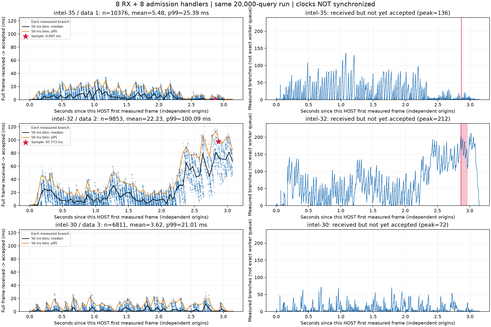
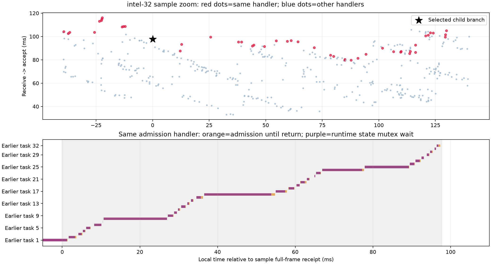

# 三数据节点接纳等待时序分析

离线分析既有 `receive_admission_20261021/cases/confirm_r1_rx8_accept8` 的 20,000 次查询；8 个接收 reactor、每 reactor 1 个接纳线程、每节点 64 个搜索线程。没有重新运行测试或修改搜索代码。

|节点|测量查询分支数|平均接纳前等待 ms|p95 ms|p99 ms|已收完整报文但未接纳峰值|
|---|---:|---:|---:|---:|---:|
|intel-35|10376|5.478|19.557|25.391|136|
|intel-32|9853|22.231|77.314|100.089|212|
|intel-30|6811|3.616|14.758|21.011|72|

左图散点表示每个测量分支，黑线/橙线是按报文接收时间分组的 50ms 窗口中位数/p95。右图通过收到完整报文 +1、accepted -1 重建未接纳数，只含测量分支，不是真实线程池队列深度。各主机横轴分别以其首个测量报文为原点；未做跨主机时钟校准，不能据此做严格跨机因果对齐。红星/红色阴影标记之前的 p99 样例；该查询未访问 intel-30。

## 样例为什么等待 97.773ms

样例 request_id 为 `5f7ddbc1-0917-4846-aa56-2e30ec4c264d`，query_id 1082402。intel-32 接纳线程 TID 131095 在该样例等待期间，先后处理其他 32 个查询分支的接纳。这些任务的 accepted 到 accept_return 区间与样例等待区间重叠合计 **86.619ms**；其中等待 runtime 状态 mutex 的重叠合计 **80.059ms**（占 97.773ms 的 81.9%）。因此有直接证据表明：前序任务等待共享锁，占用接纳线程，造成后序报文的队头阻塞。

样例自身接纳阶段只约 1.026ms，不能代表它前面的任务耗时。一个请求的锁等待会体现在后续请求的接收排队时间中。剩余约 11.154ms 不在前序任务已记录的接纳区间内，可能涉及解码、校验、调度及未单独计时的操作，不能归因到某一个具体阶段。

这轮 intel-32 分支数量少于 intel-35，却有更严重的等待；后半程接纳前积压持续升高，1308 个分支超过 50ms。这支持接纳路径服务受阻而非仅请求总量过大。尚不能凭这些时间戳确定为什么 intel-32 的锁持有者更慢：缺少所有临界区的持有者、操作类型、持锁时间及调度切换记录。

## 代码边界与后续方向

本轮冻结源代码位于 `../receive_admission_20261021/source`。`cpp/native_server.cpp` 收齐完整帧后记录时间，再提交给本 reactor 的 worker pool；worker 完成解码后进入原生 runtime。`cpp/native_runtime.cpp` 的 accept 在 validate、重新 pack、SHA256 后记录 accepted，然后获取 runtime mutex，并在持锁期间调用 controller->register_value 和提交计算任务。因此图中 receive-to-accepted 包含排队、解码、校验，并非纯网络耗时；这一原生路径不应归因于 Python GIL。

优先建议为 runtime mutex 的各持有路径增加持锁操作和时长追踪，验证嵌套 controller 注册、清理等路径的影响，再缩短临界区或拆分锁。单独增加接纳线程可能增加对同一锁的竞争，不能保证解决该问题。本次不修改生产实现。

复现：在项目根目录运行 `.venv/bin/python test/receive_queue_timeline_20261022/analyze.py`。逐分支数据见 branches.csv；数值和样例前序任务明细见 summary.json。对原始 gzip 数据直接读取，无额外解压副本。
