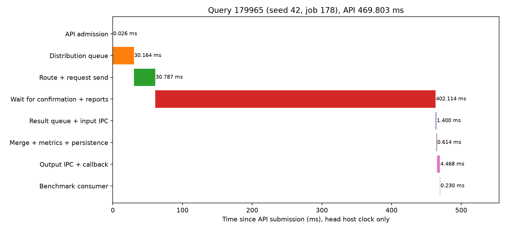
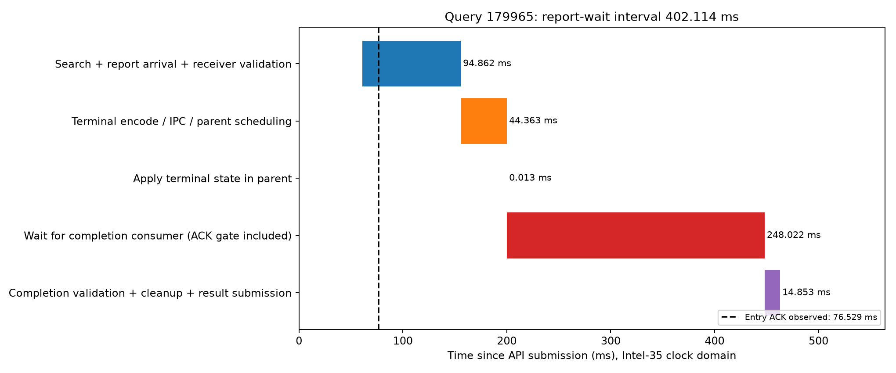

# DHDGS 多通道结果回传：实现与三机实验

已实现独立回传通道、按通道隔离的状态表/结果管道、共享身份注册和有界完成通知。最终4通道方案降低了确认/报告等待的尾部和完整查询p99，但吞吐下降，系统等待仍未达到低于100ms的目标。保留候选配置，不替换更快的旧常驻入口。

## 最终可比结果

Intel-35运行临时顶层，Intel-35/32/30各一个现有数据节点；完整seq_2M索引，200万条2560维向量。每数据节点32查询线程，固定同一2000查询、32预热、并发128、预算200、top-k10。顺序为旧/新/新/旧/旧/新，各组6000正式查询。没有降低并发、预算或召回目标，也没有重建图。

原直接分发版：16分发线程、2确认线程、16结果进程。新方案保持这些数量，增加4个报告接收进程、每通道独立终态管道/读取线程、共享注册和2个完成线程。接收子进程计入CPU和内存，不把它们当作免费资源。

|指标|原直接分发版|新4通道版|
|---|---:|---:|
|完整查询 QPS（各轮中位数）|341.740|304.655|
|完整查询 p99 ms（各轮p99的中位数）|894.074|590.836|
|完整查询平均 ms|364.872|416.192|
|确认/报告等待平均 ms|341.250|313.587|
|确认/报告等待 p99 ms|905.650|494.806|
|结果队列及输入IPC平均 ms|3.597|40.643|
|结果处理平均 ms|0.907|0.940|
|报告连接池等待平均 ms|221.176|1.633|
|报告发送至ACK平均 ms|20.533|3.062|
|数据报告就绪至调度选中平均 ms|56.756|1.403|
|Recall@10 %|97.043|97.012|
|顶层全部业务进程平均CPU核数|2.081|2.412|
|顶层进程RSS合计 GiB|1.475|1.640|

确认/报告等待均值降低约8.1%，其p99降低约45.4%；完整查询p99中位数降低约33.9%。同时QPS降低约10.9%，平均完整延迟上升，不能宣布整体吞吐优化成功。完整p99列采用各轮p99的中位数，分段p99为6000查询合并分布，二者不能直接相加或混为同一统计口径。

最终12000查询全部成功，预算、节点不重访、无顶层搜索扩展和指标完整性审计全部通过；18个节点测量窗口的控制错误增量为0。平均Recall约97%，没有通过更少搜索换延迟。三个数据PID始终为1593211、3141370、1296405。

## 改动的实际作用

原实现不是只有一条TCP连接，而是两个回调端点，每数据节点对每端点最多两条持久连接，每连接等待上一条ACK后才能复用。主进程还负责解码、校验和完成回调，共享Python运行时。扩到4个独立接收进程后，每数据节点最多8条回传连接；每通道独立ACK，不与主进程路由及结果池续执行共享GIL。

报告先经token/报告校验并进入接收者的查询状态，再ACK；完成分支树验证后发送整查询终态。节点成员控制和大终态报告使用分离管道。查询按通道绑定，局部慢连接不会阻塞其他通道；部分帧、重复报告、冲突终态、ACK丢失和接收进程故障均有回归。接收进程失败会明确使查询失败，本版未实现透明故障恢复。

shared注册在发查询前发布小身份记录，接收进程能处理早于入口ACK的报告，无需注册往返；预算来自每查询记录，支持热更新。使用短进程锁保护共享记录，并非不安全的无锁状态表。父侧报告读取、pending及会话查找按通道拆锁；全局只保留接纳与成员关系。最终注销全局锁获取等待均值为0.050ms、持锁处理为0.010ms。

所有参数在 [candidate.yaml](candidate.yaml)，完整算法/并发语义见 [DESIGN.md](../../DESIGN.md#独立回传通道与报告队列2026-10-20)。启停、热配置和结果拉取见 [README.md](README.md)。数据协议兼容，三台数据服务没有重部署或重建。

## 剩余等待没有被隐藏

新方案终态发布到父侧接收平均25.459ms，完成通知排队累计平均253.769ms，结果池输入队列/IPC平均40.643ms。数据侧计算就绪累计平均仅1.214ms，分支生命周期累计约14.634ms。回传连接瓶颈得到改善，但主进程终态交付、状态清理及结果池调度仍积压。

完成队列累计值可能覆盖多次通知，不与互斥关键路径重复相加。墙钟减线程CPU包含锁等待、GIL竞争及操作系统调度，不能全部归因于GIL，也不能称为CPU持续忙等。数据计算线程仍在本地候选耗尽/预算达到时释放，不等待其他分支；本轮没有改变扩展函数或触发额外远端搜索。

接收线程简单增到8、改用更多完成线程、直接由终态管道读取线程提交结果、单独把Python切换间隔从0.1ms调到1ms，都没有证明整体等待进一步改善。不能通过不断加线程替代处理链容量与同步点诊断。未来若继续优化，应以主进程交付的CPU/锁/调度分别计时，评估减少消息复制及批量结果投递；这些未实施方案不计入本轮收益。

## 单查询完整时序

固定随机种子42选择正式job178：query 179965，完整API 469.803ms，Recall@10=1.00。选取规则在看延迟之前固定，不挑最快查询。

|阶段|耗时 ms|
|---|---:|
|API admission|0.026|
|Distribution queue|30.164|
|Route + request send|30.787|
|Wait for confirmation + reports|402.114|
|Result queue + input IPC|1.400|
|Merge + metrics + persistence|0.614|
|Output IPC + callback|4.468|
|Benchmark consumer|0.230|

确认/报告等待进一步按Intel-35同一时钟域拆分如下；入口ACK与这些阶段重叠，在图中单独标线。

|阶段|耗时 ms|
|---|---:|
|Search + report arrival + receiver validation|94.862|
|Terminal encode / IPC / parent scheduling|44.363|
|Apply terminal state in parent|0.013|
|Wait for completion consumer (ACK gate included)|248.022|
|Completion validation + cleanup + result submission|14.853|

## 其他指标和负载

|每查询均值|原版|新4通道|
|---|---:|---:|
|expanded|200.000|200.000|
|max_expanded_depth|10.854|10.844|
|max_cross_shard_depth|0.349|0.348|
|peer_branch_rpc_count|0.350|0.349|
|all_protocol_rpc_count|2.952|3.049|
|all_protocol_bytes|31667.391|31680.796|
|file_read_bytes|2457600.000|2457600.000|
|pread_ms|0.693|0.725|
|exact_distance_ms|2.510|2.518|
|rabitq_ms|3.679|3.876|
|server_thread_cpu_ms|11.675|12.026|

协议字节为应用层消息计数，不等同包含TCP/IP头的物理网卡字节。新增通道不等于报文合并：RPC和字节总量没有因此显著减少。三节点所有最终窗口物理读增量均为0，测试命中热页缓存，pread是逻辑文件读取耗时，不能当作真实SSD介质读延迟；本轮未重新测构建时间。

|数据节点|原版平均CPU核数|新版平均CPU核数|
|---|---:|---:|
|Intel-35 / data-0|1.801|1.560|
|Intel-32 / data-1|1.992|1.817|
|Intel-30 / data-2|1.137|0.981|

完整节点RSS、读写量、CPU采样、每查询召回/延迟/分支与网络计数在各轮runs目录。顶层RSS合计可能重复计算共享页，不视为物理独占内存。

## 消融与可复现证据

共41轮、82000条正式查询，全部成功；不同阶段属于不同时间窗口，只在各阶段内部作受控比较，不能跨表直接相减宣称因果收益。初步故障测试另外运行，不混入性能结果。

|阶段/模式|QPS中位数|完整p99中位数 ms|
|---|---:|---:|
|线程通道，完成队列 / direct|325.199|1295.768|
|线程通道，完成队列 / channels2|299.890|1007.753|
|线程通道，完成队列 / channels8|266.519|1488.864|
|独立接收进程，注册往返 / direct|336.675|892.235|
|独立接收进程，注册往返 / process2|285.548|978.434|
|独立接收进程，注册往返 / process4|277.589|586.962|
|独立接收进程，注册往返 / process8|275.836|605.012|
|共享身份注册，完成队列 / direct|340.355|1104.922|
|共享身份注册，完成队列 / shared4|295.211|555.001|
|共享身份注册，完成队列 / shared8|288.660|593.206|
|终态读取线程直接提交合并 / direct|321.361|1055.443|
|终态读取线程直接提交合并 / inline4|299.227|1107.038|
|线程切换间隔消融 / direct|339.528|1079.381|
|线程切换间隔消融 / direct1|353.824|1045.042|
|线程切换间隔消融 / inline4|292.476|1024.984|
|最终：父侧状态分通道 / direct|341.740|894.074|
|最终：父侧状态分通道 / shared4|304.655|590.836|

`completion16`、`no_watchdog`、`lock_probe`各为一轮诊断，保留函数CPU/墙钟计时；不是最终选择依据。空deadline线程移除没有测得收益。最终372项完整回归通过；另32真实HTTP查询、HTTP管理发起32查询benchmark、结果collect及正常关闭通过，确认4接收进程和16结果进程。

最终证据：

- [analysis.json](striped/analysis.json)、[各轮结果](striped/rounds.csv)、[全部指标汇总](striped/metrics.csv)。
- [逐查询接收/交付计时](striped/receiver_timings.csv)、[数据控制窗口](striped/control_windows.csv)。
- [随机查询完整记录](striped/selected_query.json)、[互斥时间表](striped/selected_query_timeline.csv)、[等待细分](striped/selected_wait_detail.csv)。
- [最终回归日志](regression_final.log)、[真实HTTP验证](http/verification.json)。
- 各轮 `cases/*/runs/*/queries.jsonl.gz` 保存全部查询及分支报告，`nodes_before/after.json.gz` 保存节点原始控制时间点和负载；结果进程JSONL为返回前快照。

常驻旧入口仍运行，全部临时实验入口已关闭。候选配置可单独启动；它按既定p99优先策略提供实验选择，但等待低于100ms和更高QPS均仍未达成。
