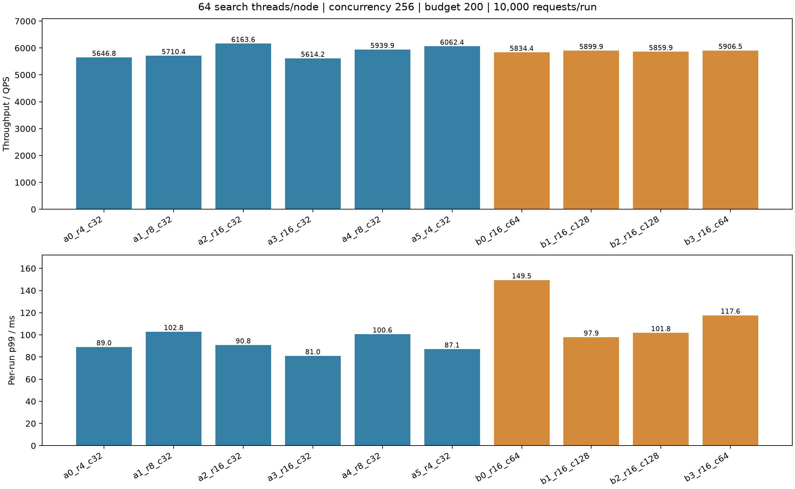
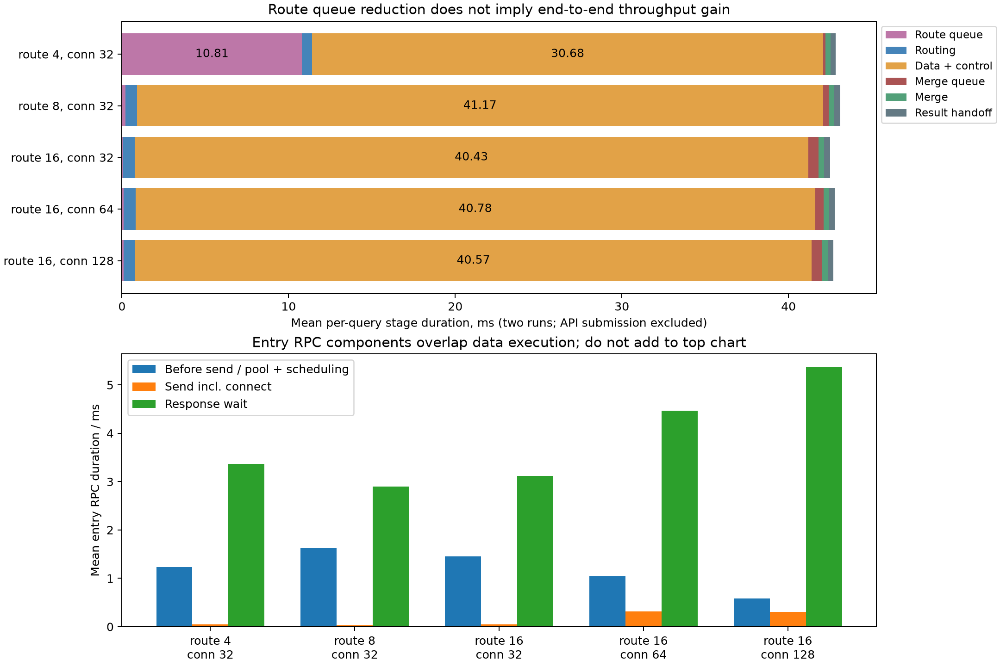

# 顶层路由与入口派发容量实验

固定三机Intel-35/32/30，每节点64查询线程、并发256、搜索预算200、合并线程4、预热32。每轮10000请求（相同2000查询重复5次）。阶段A只改顶层路由线程；阶段B只改顶层每目标连接上限。数据节点连接上限保持32。顶层连接参数同时用于独立的入口与心跳客户端，不改变事件循环线程数。

|轮次|路由线程|顶层连接/目标|QPS|p99 ms|平均ms|Recall@10|
|---|---:|---:|---:|---:|---:|---:|
|a0_r4_c32|4|32|5646.75|89.04|44.29|0.97032|
|a1_r8_c32|8|32|5710.39|102.85|43.93|0.97028|
|a2_r16_c32|16|32|6163.59|90.79|40.50|0.97036|
|a3_r16_c32|16|32|5614.22|80.99|44.56|0.97038|
|a4_r8_c32|8|32|5939.89|100.61|42.37|0.97029|
|a5_r4_c32|4|32|6062.42|87.07|41.47|0.97027|
|b0_r16_c64|16|64|5834.40|149.49|42.97|0.97040|
|b1_r16_c128|16|128|5899.87|97.85|42.63|0.97036|
|b2_r16_c128|16|128|5859.89|101.84|42.85|0.97026|
|b3_r16_c64|16|64|5906.48|117.63|42.64|0.97028|

## 分阶段等待

以下为每查询均值，单位ms。发送前排队为RPC提交至网络客户端分配处理的间隔，混合连接容量等待与事件循环调度；响应等待包含远端处理与网络事件循环，不能称为纯网络耗时。派发/响应与数据执行重叠，不能相加为总延迟。

|轮次|路由队列|路由执行|入口发送前排队|入口发送含连接|入口响应等待|数据与控制|计算就绪累计|搜索执行累计|搜索CPU累计|
|---|---:|---:|---:|---:|---:|---:|---:|---:|---:|
|a0_r4_c32|2.373|0.581|1.304|0.047|3.046|40.432|0.831|10.661|10.572|
|a1_r8_c32|0.253|0.690|1.540|0.027|2.555|41.929|0.882|10.642|10.542|
|a2_r16_c32|0.034|0.675|2.182|0.050|3.558|38.346|1.130|10.656|10.547|
|a3_r16_c32|0.073|0.728|0.721|0.040|2.672|42.510|0.910|10.637|10.526|
|a4_r8_c32|0.162|0.696|1.706|0.032|3.247|40.411|1.103|10.640|10.544|
|a5_r4_c32|19.238|0.613|1.161|0.039|3.690|20.932|1.089|10.978|10.889|
|b0_r16_c64|0.054|0.774|1.063|0.312|4.987|40.580|1.167|10.616|10.513|
|b1_r16_c128|0.080|0.715|0.500|0.519|5.581|40.820|1.171|10.887|10.783|
|b2_r16_c128|0.123|0.693|0.668|0.091|5.157|40.323|1.142|10.871|10.766|
|b3_r16_c64|0.124|0.681|1.028|0.328|3.944|40.973|1.082|10.911|10.794|

## 负载

CPU核数为进程CPU时间除以快照窗口，数据节点窗口包含快照采集时间，不能用作精确瞬时CPU饱和度。

|轮次|Intel-35数据CPU核|Intel-32数据CPU核|Intel-30数据CPU核|顶层CPU核|物理读字节|
|---|---:|---:|---:|---:|---:|---:|
|a0_r4_c32|15.56|18.13|10.21|11.33|0|
|a1_r8_c32|15.81|18.29|9.95|12.22|0|
|a2_r16_c32|17.11|18.56|10.68|12.60|0|
|a3_r16_c32|15.68|17.94|10.08|12.44|0|
|a4_r8_c32|16.17|18.33|10.47|12.49|0|
|a5_r4_c32|17.22|18.97|10.59|10.95|0|
|b0_r16_c64|16.19|17.90|10.21|12.70|0|
|b1_r16_c128|17.33|18.61|10.62|12.53|0|
|b2_r16_c128|16.78|18.36|10.59|12.40|0|
|b3_r16_c64|15.58|16.83|9.85|12.15|0|

## 验证与边界

全部结果通过零失败、预算/无重复访问/无路由扩展审计，真实数据线程数64，暂存没有触发容量溢出。服务时延以完整原生结果交付Future为终点，后置编码、JSON持久化与统计不计入QPS。每轮仅数秒，是热缓存短测；两轮均值不能证明统计显著性。原始时间戳、有效YAML、源码快照和审计均保存在各轮目录。未修改生产配置或搜索代码。

## 分组结论

每组两轮算术平均；p99列是每轮p99的均值，不是合并样本p99。

|路由线程|顶层连接/目标|QPS|p99 ms|路由排队ms|发送前排队ms|入口响应等待ms|
|---|---:|---:|---:|---:|---:|---:|
|4|32|5854.58|88.06|10.805|1.232|3.368|
|8|32|5825.14|101.73|0.208|1.623|2.901|
|16|32|5888.91|85.89|0.054|1.452|3.115|
|16|64|5870.44|133.56|0.089|1.045|4.466|
|16|128|5879.88|99.85|0.102|0.584|5.369|

路由线程4→16，QPS变化+0.59%。路由队列确实缩短，但数据与控制区间增加，整体没有稳定吞吐增益。不能将路由排队长等同于路由计算是唯一瓶颈。

顶层连接32→64：QPS -0.31%，每轮p99均值 +55.51%。
顶层连接32→128：QPS -0.15%，每轮p99均值 +16.25%。

## 数据与控制区间的进一步观测

以下仍为每查询均值，单位ms；分支累计时长可能重叠，不可直接从端到端时长相减计算网络时间。

|路由/连接|数据与控制|分支累计总时长|分支计算就绪|分支搜索执行|分支派发收尾|最后结果收到至合并入队|结果全部处理后等入口ACK|
|---|---:|---:|---:|---:|---:|---:|---:|---:|
|(4, 32)|30.682|15.021|0.960|10.819|2.900|0.570|0.027|
|(8, 32)|41.170|14.345|0.993|10.641|2.362|0.614|0.007|
|(16, 32)|40.428|14.203|1.020|10.646|2.193|0.612|0.010|
|(16, 64)|40.777|15.600|1.124|10.763|3.367|0.593|0.011|
|(16, 128)|40.572|16.202|1.157|10.879|3.815|0.669|0.064|

实际代码中的routes线程在异步提交入口RPC后返回，没有等待ACK；入口网络客户端由单个事件循环处理。pool_wait_ms覆盖客户端incoming/waiting队列与连接分配前调度间隔，不能精确区分连接占用和事件循环调度。response_wait_ms覆盖发送结束至响应处理结束，不能精确区分远端接收排队、ACK发送和本地事件循环处理。当前数据不能证明其中任何一项是唯一瓶颈。

下一步应在上述路径加入分段时间戳与队列/连接占用采样：客户端入队→事件循环取走→获得连接→发送完成；数据端报文收齐→处理开始→ACK入发送队列→实际发出；结果报告同样记录。各段均用本机单调时钟，跨机器不直接相减。随后才有依据对单事件循环增加分片或资源。当前实验只调整已有配置，没有引入未经对照的网络实现改动。

测试服务已关闭，原有三个数据节点及127.0.0.1:22091管理端口仍可达；十轮源码hash与查询选择一致。
