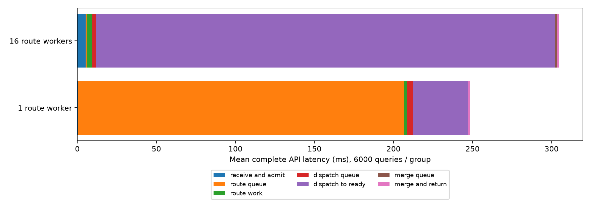
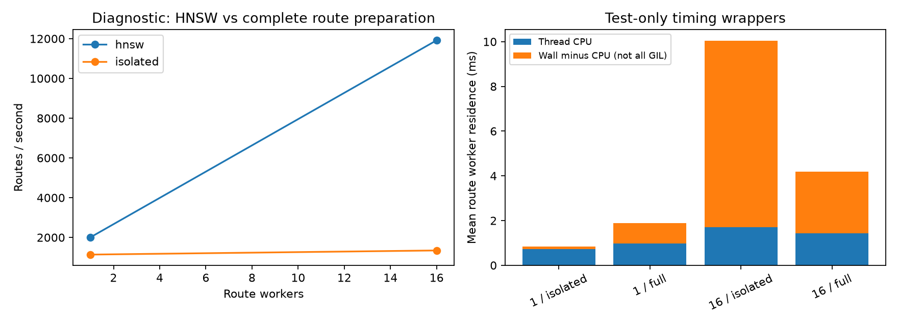

# 路由线程释放、16线程对照与排队定位

2026-10-20。本轮定位对象是单进程顶层流水线；常驻双进程旧入口未切换。已把`configs/dhdgs.yaml`中的流水线路由线程默认值改为16，本目录`candidate.yaml`启用单进程16路由线程。修改配置不改变已运行进程，数据节点程序和参数保持不变。

## 结论

单进程实现已有路由线程池，路由线程完成准备、加入派发队列后立即返回，不等待入口ACK或查询结果。新增的阻塞实验验证了这一点，因此本轮没有虚构一个“释放线程”的新优化。

原来的1线程路由队列长，是128个在途查询竞争单个路由工作线程。该线程的任务不仅是C++ HNSW搜索，还包括向量准备、RaBitQ入口估距、候选及备用入口构造、配置签名和初始请求构造；这些操作又受到同进程其他Python线程的调度影响。普通性能实验中，整个路由准备段平均1.924ms，单线程处理上限约520次/秒，实测QPS中位数492.48，已接近该阶段容量。平均206.18ms的排队与约百条请求在单路由队列中等待的量级一致；不能因为单次计算只有毫秒级，就推断百条请求排队也应只有毫秒级。

**16线程确实消除了大部分路由排队：平均206.18ms降至0.813ms，p99由296.74ms降至8.35ms。** 但完整查询p99和QPS变差，主要等待转移到结果回传链路。应将“路由队列变短”和“完整查询变快”分别验收。

## 受控性能对照

完整seq_2M索引、Intel-35顶层及data-0、Intel-32 data-1、Intel-30 data-2；每数据节点32查询工作线程、预算200、top-k10、并发128；每组相同2000查询、32预热，按1/16/16/1/1/16交错，三次重复。每轮独立回调端口，避免缓存旧连接重试。结果来自内部异步查询API，未计入外部HTTP请求解析；全部内部排队、结果返回与压测消费者调度计入。

|指标|1路由线程|16路由线程|
|---|---:|---:|
|QPS（三轮中位数）|492.48|408.54|
|完整查询p99（三轮中位数，ms）|387.74|611.24|
|完整查询均值（6000查询，ms）|248.20|304.62|
|接收队列均值，ms|0.591|5.001|
|路由队列均值，ms|206.178|0.813|
|路由准备段均值，ms|1.924|3.443|
|派发队列均值，ms|3.445|2.448|
|派发线程开始至完整结果就绪，ms|34.734|290.351|
|合并队列均值，ms|0.273|1.021|
|数据节点计算就绪队列累计均值，ms|0.520|0.496|
|数据分支本地生命周期累计均值，ms|13.056|13.218|
|顶层平均使用CPU核数|1.431|1.547|
|Recall@10|97.027%|97.038%|
|失败查询|0/6000|0/6000|



上图各阶段在顶层同一时钟域内互斥并完整覆盖API；“派发至就绪”包含入口派发、数据计算、子分支、报告发送排队及报告处理，不全部是网络时间。数据节点累计指标不可再叠加到图中。逐轮p99有波动：1线程328.87/387.74/554.83ms，16线程621.98/596.26/611.24ms。本窗口三次16线程均比三次1线程更慢，但仍只是当前负载与环境的结果。

12000条正式查询全部成功，预算不超过200、无节点重复访问及指标完整性审计通过。18个数据节点测量窗口控制错误增量为0，16191个对应正式查询的结果控制事件没有失败；物理读取增量均为0，因此是热页缓存测试，不能用于评价冷SSD吞吐。

## 排除“路由线程等待结果”

`verify_release.py`使用完整索引和真实三台数据服务，固定1个路由线程、每组128查询，在测试包装器内分别阻塞派发、ACK返回、完成Future通知。每组都观察到同一个路由线程完成128次路由，且在放开阻塞前成功执行额外哨兵任务，此时128个查询输出仍全部未完成。

|人为阻塞点|阻塞时完成路由数|实际路由线程数|入队返回至路由任务返回均值，ms|
|---|---:|---:|---:|
|派发线程发送前|128|1|0.00497|
|入口RPC收到ACK后暂不交给派发逻辑|128|1|0.01241|
|完整报告到齐后暂不通知完成|128|1|0.00690|

前两组阻塞时4个派发线程正在等待、派发队列124项；第三组128份完整结果已收齐，但输出仍未完成，路由线程仍可复用。放开阻塞后384个查询全部成功。人为等待仅用于验证线程占用语义，不纳入吞吐对照。新增对应回归测试，`test_head_pipeline.py`共11项通过。

实现路径是`search.py`的`operation = head_hub.enqueue(dispatch)`之后`yield operation`；`PipelineFlow._step()`注册完成回调后返回，结果到达后由独立merge线程池续执行。等待中的查询占用生命周期容量和Future状态，不占路由线程。

## 路由线程实际在做什么

另用测试包装器测量线程墙钟和线程CPU；这两组各2000个真实查询，仅作诊断，不混入上面无包装器的性能结论。

|1路由线程的阶段|完整系统墙钟均值，ms|完整系统线程CPU，ms|独立路由墙钟，ms|
|---|---:|---:|---:|
|向量准备|0.379|0.045|0.131|
|HNSW搜索调用|0.717|0.516|0.471|
|RaBitQ入口估距调用|0.255|0.065|0.042|
|重新计算配置签名|0.077|0.071|0.045|
|派发入队调用|0.031|0.027|0.004|
|其余准备与线程池阶段处理|0.418|0.246|0.149|
|合计|1.877|0.970|0.842|

“其余”包括候选映射、NumPy切片、候选列表、UUID/状态构造、预算和scale准备、Future回调注册及测量开销，不是假定全部为计算。每段均含函数调用边界和重新获取GIL的影响。派发入队均值仅0.031ms，因此现有证据不支持它是单线程206ms排队的主要根源。

独立路由实验运行完全相同的路由准备生成器，到首次yield时停止，不发送网络请求；纯HNSW实验只调用共享Router的search接口。两者均使用同样2000查询、最多128在途任务，在真实完整路由索引上运行。

|隔离实验|1线程处理率，次/秒|16线程处理率，次/秒|
|---|---:|---:|
|HNSW调用及Python绑定|2007.03|11916.11|
|完整路由准备，不发送网络请求|1137.52|1345.25|



HNSW本身可以并发，16线程约提高5.94倍；完整路由准备只提高约18.3%。`cpp/native.cpp`中的Router在只读搜索阶段释放GIL，没有覆盖整段HNSW搜索的应用级互斥锁；RaBitQ主要计算也释放GIL。问题集中在原生计算之外的Python准备及共享运行时调度，而非HNSW算法完全串行。

完整系统1线程路由阶段墙钟1.877ms、线程CPU0.970ms；16线程分别4.198ms、1.432ms。独立16线程路由阶段驻留均值10.038ms、线程CPU1.714ms；虽然多线程下驻留增长，总吞吐仍略提高，因为多个查询驻留重叠。墙钟减CPU仅表示本线程未消耗CPU的时间，**不能直接标注为GIL等待**；它还包含调度、条件锁和其他阻塞。证据支持Python/GIL与调度竞争限制扩展性，但本轮未独立测得GIL等待比例、每把锁等待比例或内存带宽饱和度，不宣称这些项的精确占比。

另外，原`latency_breakdown_ms.routing_wall_ms`从API提交时间开始计时，含路由前排队，不能用它当作纯HNSW计算耗时。本轮使用`head_pipeline.route_started_ns`至`dispatch_enqueued_ns`划分路由准备，另用调用包装器测HNSW；避免指标名称造成误读。

## 16线程之后等待转移到了哪里

按正式查询request_id筛选三台数据节点的原始控制事件，所有差值均在同一数据主机内计算；以下按结果控制事件平均，不与逐查询API均值直接相加。

|结果回传阶段|1路由线程，ms|16路由线程，ms|
|---|---:|---:|
|结果进入发送队列至开始发送|13.853|202.598|
|其中原生发送客户端pool_wait|13.763|202.504|
|开始发送至收到ACK|3.803|8.908|
|原生报告准备好至控制调度选中|3.771|51.005|
|原生报告准备好至开始发送|17.497|253.469|

当前每个数据节点对该顶层回调endpoint只有2条控制发送连接；每条连接一次只处理一个请求，收到ACK后才能复用。原生控制调度还受`max_pending_control: 64`限制，发送积压也可能让尚未选中的报告继续等待。顶层由一个selector线程负责结果解码、报告验证、更新查询状态、生成ACK，并与16个路由线程共享Python解释器。路由快速出队后，更多查询进入下游，结果返回流量更集中；ACK响应周期增长使连接更久不能复用，尚未发送的结果随之排队。

原生发送pool_wait是请求等待连接/发送机会的驻留时间，**不是某把Python mutex持有了203ms**；计算工作线程早已完成并释放。数据计算就绪等待仍约0.5ms，本地分支生命周期仍约13ms，不能把253ms报告准备至发送解释为数据线程仍在做搜索。当前限制是完成控制链路的服务能力和有限在途连接；还需单独消融连接数与原生接收/处理能力，才能判定两者的各自改善幅度。单纯增加连接也可能只把队列转移到顶层接收端。

## 后续优化依据

保留已经正确的“路由入队即释放”语义。下一步若优化完整延迟，应优先处理报告回传积压，同时减少路由阶段的Python工作：缓存不随查询变化的execution_signature（在配置版本变化时重算）、把向量准备/入口估距/候选和请求准备合并成更粗的原生调用，并分别测量路由及结果处理的服务率。原生回调接收和处理可继续保持一个顶层业务进程，符合减少IPC的要求。

这些属于根据本轮证据提出的后续方案，本轮没有擅自改变结果完成条件、召回预算、连接上限或搜索决策，也没有宣称实现等待低于100ms。16线程配置已保存供继续实验，当前常驻入口仍为原双进程版本，所有临时诊断顶层均关闭。

## 复现与工件

从`/sharenvme/usershome/xulihan`执行；`run_scan.py`、`profile_routes.py`防止覆盖已有轮次，重新运行须使用新的实验输出目录和回调端口，且不得与其他负载测试重叠。

```sh
gene_database/DHDGS/.venv/bin/python gene_database/DHDGS/test/route_worker_release_20261020/run_scan.py
gene_database/DHDGS/.venv/bin/python gene_database/DHDGS/test/route_worker_release_20261020/verify_release.py
gene_database/DHDGS/.venv/bin/python gene_database/DHDGS/test/route_worker_release_20261020/profile_routes.py 1
gene_database/DHDGS/.venv/bin/python gene_database/DHDGS/test/route_worker_release_20261020/profile_routes.py 16
gene_database/DHDGS/.venv/bin/python gene_database/DHDGS/test/route_worker_release_20261020/analyze.py
```

`experiment.yaml`记录性能对照配置；`candidate.yaml`是单进程16路由线程候选配置；`cases/`保存12000查询原始指标、各节点资源和前后快照；`snapshot/`、`source_hashes.json`保存冻结源码。`analysis.json`、`cases.csv`、`control_windows.csv`是汇总；`release_*.json`保留阻塞验证原始时刻；`profile_1/`和`profile_16/`保留调用级墙钟/CPU记录及独立吞吐实验。`unit_tests.log`记录新增线程复用回归通过。
