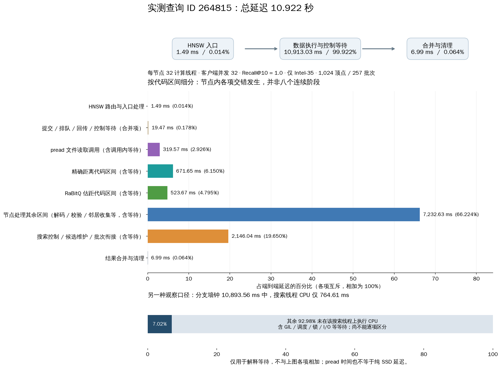
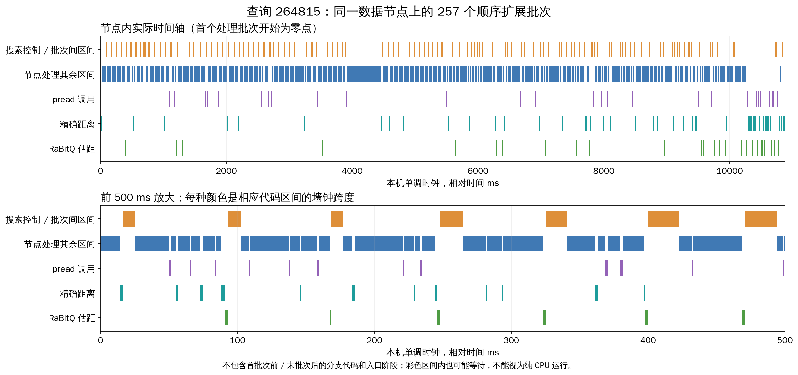

# 查询 264815 的时延拆解

选择规则：在每节点 32 线程 / 客户端并发 32 组中，从成功、单分支、Recall@10=1 的查询中选择最接近整组成功查询延迟中位数的一条。
该查询 10,921.51 ms，整组中位数 10,928.71 ms。只访问 Intel-35，无跨数据节点搜索。单分支选择用于避免并行时间重复累计，不代表所有查询的组成。

| 代码区间 | 时间 ms | 端到端占比 |
|---|---:|---:|
| HNSW 路由与入口处理 | 1.488 | 0.0136% |
| 提交 / 排队 / 回传 / 控制等待（合并项） | 19.470 | 0.1783% |
| pread 文件读取调用（含调用内等待） | 319.571 | 2.9261% |
| 精确距离代码区间（含等待） | 671.653 | 6.1498% |
| RaBitQ 估距代码区间（含等待） | 523.669 | 4.7948% |
| 节点处理其余区间（解码 / 校验 / 邻居收集等，含等待） | 7232.633 | 66.2237% |
| 搜索控制 / 候选维护 / 批次衔接（含等待） | 2146.038 | 19.6496% |
| 结果合并与清理 | 6.988 | 0.0640% |

所有区间是墙钟跨度，包含该区间内发生的等待。细分源于原始 trace，检查了批次顺序、跨度互斥和累计值与统计字段一致。
节点处理其余区间 = service_ms − pread − 精确距离 − RaBitQ；搜索控制与批次衔接 = branch_wall_ms − service_ms。
分支外提交/排队/返回/控制是合并残差，不能当作纯网络耗时；路由与合并来自入口端计时。
分支墙钟 10893.564 ms，搜索线程 CPU 764.609 ms，相当于 7.02%。
差值包含 GIL、操作系统调度、锁、I/O 等等待和其他线程执行的工作；没有独立的 GIL/锁/纯网络/纯 SSD 计时，不能伪造这些成分的占比。
本查询逻辑读取 12 MiB / 1024 次 pread；所在整组进程物理读取统计为零，属于热页缓存测量。

## 同一查询在不同线程数下（客户端并发均为 32）

| 线程/节点 | 端到端 ms | 分支执行墙钟 ms | 搜索线程 CPU ms | 分支外提交/排队/返回/控制 ms |
|---:|---:|---:|---:|---:|
| 1 | 4294.418 | 184.877 | 175.816 | 4102.379 |
| 2 | 7546.871 | 707.201 | 370.955 | 6832.451 |
| 4 | 11352.778 | 2304.887 | 539.835 | 9035.593 |
| 8 | 16003.172 | 5796.013 | 698.408 | 10175.050 |
| 16 | 19541.301 | 8824.271 | 777.548 | 10708.703 |
| 32 | 10921.509 | 10893.564 | 764.609 | 19.470 |

以上都扩展 1024 顶点、Recall@10=1；单条查询的调度位置不同，不能代替整组统计。

原始查询见 selected_query.json；选择与来源见 selection.json；数值见 breakdown.json / breakdown.csv / same_query_threads.csv。
图表用 Matplotlib 生成，PNG 和 SVG 均保留，可运行 plot_query.py 复现。
