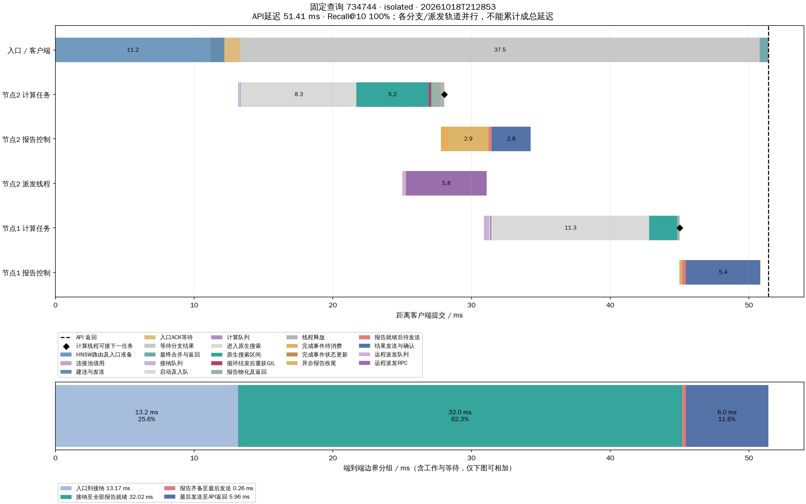

# 无并发单查询时间分解

2026-10-18，运行 `20261018T212853`。只提交1条查询，实际峰值在途1，**端到端 51.406 ms，Recall@10 100%**。

使用此前固定随机选择的查询734744（query row 73656）。完整seq_2M索引、Intel-35本机三个TCP数据进程；每节点32计算线程、搜索预算200及算法配置保持上一轮fastoff不变。只有一个客户端进程、一个查询工作线程；节点仍允许该查询按扩展函数生成跨节点分支。

**没有预热查询，整个测试仅执行这一个查询。** 服务和索引装载在计时前完成；查询自身包含首次入口准备、TCP建连和工作线程进入原生调用之前的准备。未清空OS页缓存，三个节点物理storage_read_bytes增量均为0，故不是冷SSD测试。

上图不同轨道会重叠；入口“等待分支结果”覆盖下方正在进行的搜索与通信，不能再计作额外纯等待。下图按端到端事件边界划分，可相加但包含工作与等待。黑色菱形表示计算线程可领取下一任务。

## 分支阶段

| 阶段 | 节点2 / ms | 节点1 / ms |
|---|---|---|
| 接纳队列 | 0.107 | 0.342 |
| 固定计算队列 | 0.049 | 0.100 |
| 工作线程入口→C++循环开始 | 8.282 | 11.322 |
| C++搜索循环 | 5.230 | 2.010 |
| 循环结束→线程可复用 | 1.127 | 0.201 |
| 完成事件等待消费 | 0.272 | 0.087 |
| 完成消费→报告就绪 | 2.937 | 0.099 |
| 报告就绪→发送线程开始 | 0.227 | 0.263 |

以上不是互斥端到端拆分，不应全部相加。工作线程入口→C++循环开始包含Python适配、可能的首次导入、准备和线程调度；其中大部分发生在native_call之前，现有时间戳不足以逐项归因，不能称为计算队列等待或SSD耗时。

[原生搜索细分图](analysis/isolated/20261018T212853/query_search_detail.png) · [全部轨道事件CSV](analysis/isolated/20261018T212853/query_timeline.csv) · [阶段CSV](analysis/isolated/20261018T212853/branch_stages.csv)

## 与2000查询突发对照

相同查询在上一轮2000查询突发中总延迟1507.85ms，节点2/1的接纳队列等待分别262.54/592.42ms；本次入队后等待降至0.11/0.34ms（若从accepted计至出队，则为0.13/0.36ms）。该差异说明旧等待主要随并发积压出现，单次向量搜索本身没有固定的几百毫秒等待。它不意味着高并发等待问题已经解决，也不能由一个样本估计p99或稳态吞吐。

上一轮另有全体分支时间戳佐证：三个节点在相邻提交之间平均间隔1.269/1.276/1.721ms，而submit调用平均仅0.032/0.064/0.026ms。间隔可能包含等待新任务、共享队列锁竞争、GIL与OS调度，不能全归于某一种锁；计算线程池内部平均队列等待仅4.29ms。长队列主要位于提交计算线程池之前。

本次展开200个顶点，访问2个数据节点。跨数据节点派发1次，全部协议RPC共5次、82031字节；逻辑文件读取2457600字节。协议字节不含TCP/IP等底层开销。

## 记录与复现

[实验YAML](isolated/experiment.yaml) · [负载YAML](isolated/load_plan.yaml) · [执行日志](execution.log) · [源文件哈希](sources.json)

运行 `.venv/bin/python test/single_query_20261018/isolated/run_load.py`（DHDGS目录下），然后依次运行本目录analyze.py、plot_query.py isolated、plot_search.py isolated。端口20361–20363须空闲。脚本不会修改生产搜索代码，所有运行写入独立runs目录。

已核验真值、全局预算、固定计算线程、扩展批准、无节点重复访问、队列排空和进程退出。单查询原始summary中的QPS包含实验启动闸门等待，不作为吞吐结论；单样本p99也不具有分布意义。
