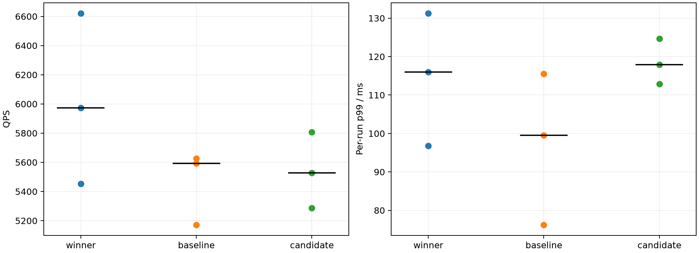
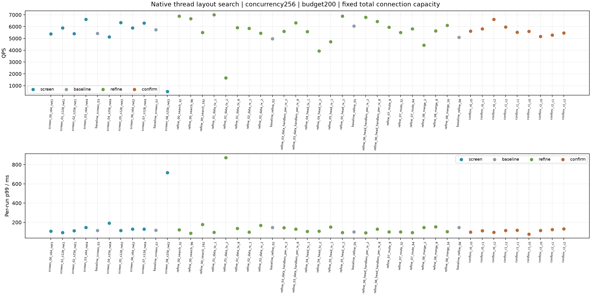

# 三机线程布局与QPS实验

共45轮、810000次正式查询。GitHub源码提交4093380；所有轮次应用源码与二进制不变，仅调整配置。

## 清理及实验条件

40个早于2026-10-20的本地旧测试目录已清理，释放约12.84GiB；全量索引与在用配置迁至artifacts。三个旧路径仅保留运行兼容链接。原始删除清单、保留文件及空间变化见cleanup_completed.json。

Intel-35同时运行顶层与数据节点0，Intel-32为数据节点1，Intel-30为数据节点2。全量seq_2M索引、2560维、top10、预算200、并发256，200次预热；相同2000条验证查询重复。服务延迟从实际进入API至返回计时，不包含客户端等待并发额度的backlog；offered_to_complete_ms另存完整批次排队时间。筛选每轮10000请求，最终每布局3轮50000请求并交替顺序。

搜索为C++原生固定线程，sync_pread；父报告独立提前发布。每个逻辑发送客户端到每目标的总连接上限128固定，随TX线程数分摊。接收handler排队总容量4096固定；所有reactor固定min=max。网络模块与动态控制单元互斥，控制单元本轮保持1；旧Python线程参数和sync_pread下不工作的IO池参数不作为有效旋钮。

结果先暂存在内存，测量结束后独立离线处理；初期短测暂存上限4GiB，后续及全部确认轮次32GiB。所有纳入轮次均无暂存溢出。

## 三轮确认结果

|布局|QPS中位数|QPS范围|各轮p99中位数 ms|合并请求/合并运行时长 QPS|
|---|---:|---:|---:|---:|
|最高吞吐|5972.80|5453.62–6621.83|116.03|5978.41|
|基线|5592.52|5171.52–5626.02|99.51|5455.31|
|候选|5527.43|5287.39–5808.15|117.89|5532.84|

实测最高吞吐组合相对基线中位QPS变化+6.80%。各轮p99的中位数不是汇总所有请求后的p99。

## 实测最高吞吐线程布局

|角色|配置|数量|
|---|---|---:|
|每数据节点搜索线程|search|32|
|数据节点发送reactor/每逻辑客户端|data_tx|1|
|数据节点接收reactor|data_rx|4|
|每接收reactor数据handler|data_handlers_per_rx|4|
|顶层路由线程|route|16|
|顶层合并线程|merge|4|
|顶层发送reactor/每逻辑客户端|head_tx|4|
|顶层接收reactor|head_rx|4|
|顶层每接收reactor报告handler|head_handlers_per_rx|4|

线程比例按明确角色记录在best_layout.yaml。数据节点“搜索:请求handler:接收reactor:派发TX:报告TX:完成控制”为`32:16:4:1:1:1`。顶层“路由:合并:报告handler:接收reactor:入口TX:租约TX”为`16:4:16:4:4:4`。

每个逻辑客户端独立创建TX线程，因此data_tx/head_tx不是该进程全部发送线程数。数据接收reactor还各有一个独立管理handler；网络监测、状态维护、Python API/采样等线程另计，下面实际进程线程数用于核对。

## 所有轮次

|轮次|搜索|数据TX/RX/handler每RX|顶层路由/合并|顶层TX/RX/handler每RX|QPS|p99 ms|Recall@10|网络指标完整|
|---|---:|---|---|---|---:|---:|---:|---|
|screen_00_s64_net1|64|1/1/4|16/4|1/1/4|5379.31|108.11|0.97022|True|
|screen_01_s128_net1|128|1/1/4|16/4|1/1/4|5900.60|93.36|0.97024|True|
|screen_02_s256_net1|256|1/1/4|16/4|1/1/4|5407.83|112.78|0.97022|True|
|screen_03_s64_net4|64|4/4/4|16/4|4/4/4|6619.58|146.24|0.97023|True|
|baseline_screen_03|64|1/1/4|16/4|1/1/4|5422.80|115.54|0.97035|True|
|screen_04_s256_net4|256|4/4/4|16/4|4/4/4|5123.39|192.64|0.97014|True|
|screen_05_s128_net2|128|2/2/4|16/4|2/2/4|6339.82|115.94|0.97029|True|
|screen_06_s64_net2|64|2/2/4|16/4|2/2/4|5891.93|129.21|0.97026|True|
|screen_07_s128_net4|128|4/4/4|16/4|4/4/4|6308.81|129.16|0.97012|True|
|baseline_screen_07|64|1/1/4|16/4|1/1/4|5728.13|117.93|0.97023|True|
|screen_08_s256_net2|256|2/2/4|16/4|2/2/4|507.24|717.23|0.97016|True|
|refine_00_search_32|32|4/4/4|16/4|4/4/4|6892.01|121.54|0.97025|True|
|refine_00_search_96|96|4/4/4|16/4|4/4/4|6664.24|86.58|0.97031|True|
|refine_00_search_192|192|4/4/4|16/4|4/4/4|5503.35|177.10|0.97044|True|
|refine_01_data_tx_1|32|1/4/4|16/4|4/4/4|7003.53|95.82|0.97029|True|
|refine_01_data_tx_2|32|2/4/4|16/4|4/4/4|1649.41|872.86|0.97026|False|
|refine_01_data_tx_8|32|8/4/4|16/4|4/4/4|5913.87|136.38|0.97036|True|
|refine_02_data_rx_1|32|4/1/4|16/4|4/4/4|5860.64|97.59|0.97040|True|
|refine_02_data_rx_2|32|4/2/4|16/4|4/4/4|5442.79|169.16|0.97023|True|
|baseline_refine_02|64|1/1/4|16/4|1/1/4|4974.67|145.53|0.97038|True|
|refine_03_data_handlers_per_rx_2|32|4/4/2|16/4|4/4/4|5605.71|143.33|0.97022|True|
|refine_03_data_handlers_per_rx_8|32|4/4/8|16/4|4/4/4|6317.52|130.81|0.97038|True|
|refine_04_head_tx_1|32|4/4/4|16/4|1/4/4|5571.96|105.66|0.97033|True|
|refine_04_head_tx_2|32|4/4/4|16/4|2/4/4|3947.77|108.79|0.97026|True|
|refine_05_head_rx_1|32|4/4/4|16/4|4/1/4|4716.28|150.65|0.97036|True|
|refine_05_head_rx_2|32|4/4/4|16/4|4/2/4|6880.97|92.93|0.97036|True|
|baseline_refine_05|64|1/1/4|16/4|1/1/4|6049.27|102.28|0.97021|True|
|refine_06_head_handlers_per_rx_2|32|4/4/4|16/4|4/4/2|6797.70|90.97|0.97017|True|
|refine_06_head_handlers_per_rx_8|32|4/4/4|16/4|4/4/8|6431.04|130.88|0.97027|True|
|refine_07_route_8|32|4/4/4|8/4|4/4/4|5955.86|102.21|0.97020|True|
|refine_07_route_32|32|4/4/4|32/4|4/4/4|5506.09|101.90|0.97029|True|
|refine_07_route_64|32|4/4/4|64/4|4/4/4|5822.45|94.30|0.97024|True|
|refine_08_merge_2|32|4/4/4|16/2|4/4/4|4422.16|147.78|0.97037|True|
|refine_08_merge_8|32|4/4/4|16/8|4/4/4|5628.36|153.64|0.97035|True|
|refine_08_merge_16|32|4/4/4|16/16|4/4/4|6112.29|103.35|0.97024|True|
|baseline_refine_08|64|1/1/4|16/4|1/1/4|5083.85|145.99|0.97037|True|
|confirm_r0_c0|64|1/1/4|16/4|1/1/4|5626.02|99.51|0.97032|True|
|confirm_r0_c1|32|4/4/4|16/4|4/4/4|5808.15|112.92|0.97037|True|
|confirm_r0_c2|32|1/4/4|16/4|4/4/4|6621.83|96.75|0.97031|True|
|confirm_r1_c2|32|1/4/4|16/4|4/4/4|5972.80|116.03|0.97045|True|
|confirm_r1_c1|32|4/4/4|16/4|4/4/4|5527.43|117.89|0.97039|True|
|confirm_r1_c0|64|1/1/4|16/4|1/1/4|5592.52|76.23|0.97028|True|
|confirm_r2_c0|64|1/1/4|16/4|1/1/4|5171.52|115.55|0.97025|True|
|confirm_r2_c1|32|4/4/4|16/4|4/4/4|5287.39|124.71|0.97038|True|
|confirm_r2_c2|32|1/4/4|16/4|4/4/4|5453.62|131.29|0.97034|True|

## 最终布局负载及协议指标

|轮次|数据进程线程数0/1/2|顶层进程线程数|数据平均CPU核0/1/2|顶层平均CPU核|每query协议字节|RPC次数|pread ms|计算就绪累计 ms|
|---|---|---:|---|---:|---:|---:|---:|---:|
|confirm_r0_c0|79/79/79|33|15.76/18.49/8.85|13.69|31976|3.05|1.132|1.477|
|confirm_r0_c1|71/71/71|54|15.76/15.81/8.56|15.04|31984|3.05|0.996|9.734|
|confirm_r0_c2|65/65/65|54|14.72/13.37/8.24|16.90|32007|3.05|0.831|11.949|
|confirm_r1_c2|65/65/65|54|15.27/15.32/8.57|14.66|31988|3.05|0.900|10.318|
|confirm_r1_c1|71/71/71|54|15.78/15.92/8.45|13.92|31985|3.05|0.992|9.867|
|confirm_r1_c0|79/79/79|33|16.99/16.92/9.19|14.08|32003|3.06|0.991|1.087|
|confirm_r2_c0|79/79/79|33|14.62/17.81/8.59|12.79|31974|3.06|1.112|1.444|
|confirm_r2_c1|71/71/71|54|15.98/15.98/8.55|14.38|31984|3.05|0.965|9.859|
|confirm_r2_c2|65/65/65|54|15.43/15.66/8.25|13.40|31976|3.05|0.945|11.112|

|轮次|精确距离 ms/query|RaBitQ ms/query|搜索线程CPU ms/query|展开顶点数|最大图深度|跨分片深度|分支RPC/query|文件请求读取字节/query|三节点物理读取字节/快照窗口|
|---|---:|---:|---:|---:|---:|---:|---:|---:|---:|
|confirm_r0_c0|2.140|4.318|12.044|200.000|10.873|0.350|0.352|2457600.000|233472|
|confirm_r0_c1|1.905|4.113|11.052|200.000|10.879|0.350|0.351|2457600.000|884736|
|confirm_r0_c2|1.890|3.725|10.307|200.000|10.877|0.349|0.351|2457600.000|73728|
|confirm_r1_c2|1.906|3.936|10.705|200.000|10.877|0.349|0.351|2457600.000|479232|
|confirm_r1_c1|1.908|4.224|11.166|200.000|10.874|0.350|0.351|2457600.000|487424|
|confirm_r1_c0|2.281|4.035|11.878|200.000|10.880|0.350|0.352|2457600.000|417792|
|confirm_r2_c0|2.186|4.404|12.235|200.000|10.875|0.351|0.352|2457600.000|233472|
|confirm_r2_c1|1.979|4.284|11.436|200.000|10.879|0.350|0.351|2457600.000|647168|
|confirm_r2_c2|1.933|4.210|11.171|200.000|10.880|0.350|0.351|2457600.000|245760|

CPU平均核数采用进程快照窗口，包含快照开销，不能作为查询测量窗口的精确CPU利用率。pread为系统调用墙钟，包含页缓存命中，不等于物理SSD延迟。文件读取字节是逻辑读取量，不等于物理块设备读量；最大图深度也不等于展开顶点数。逐查询延迟、召回、跳数、网络、磁盘与CPU统计、节点trace和阶段均值均保留在每轮runs目录。

## p99时序图

选择最高吞吐布局三轮中QPS最接近其中位数的一轮：confirm_r1_c2。首先从全体请求选最接近本轮全体p99的记录；另提供跨节点查询中最接近同一全体p99的样本，不将其称为跨节点子集p99。

各主机使用本地单调时钟，分支面板不能直接对齐或相加。搜索、派发、报告可能重叠，计算线程释放后控制等待不占用该搜索线程。

## 结论边界与复现

这是所测线程空间、当前硬件、并发256和预算200下的最高吞吐布局；坐标搜索没有穷举所有交互，也不证明全局最优。主要命中热缓存；每轮仍只持续数秒，三轮重复不能替代长时间稳态实验。提高并发、改变预算、SSD冷热状态或查询分布后需重新校准。

每轮要求零失败、Recall≥95%、不重复访问/预算/无顶层扩展审计通过及内存暂存无溢出。网络指标完整性单独保留，不按该标记删除慢轮次或慢请求。部分延迟超过心跳周期的查询在交付时仍有租约RPC在途，网络字节可能尚未齐，不能将这些计数伪装为完整。原始交付记录按SHA256无损压缩，最终queries.jsonl.gz含独立离线补齐的网络计数。应用源码哈希、各机扩展哈希、硬件和配置见source_hashes.json/deployed_provenance.json/hardware.json及每轮plan/head_effective/spec。

执行入口为run_sweep.py，参数集中在sweep.yaml；筛选/细调和最终确认布局由progress.json完整保存。最终配置另存best_layout.yaml，未自动改变生产模板或重启220xx服务。

## 结果解释与剩余等待

最高吞吐布局的三轮中位QPS比基线高6.80%，但各轮p99中位数增加16.60%（99.51→116.03ms）；两组QPS范围重叠，仅3轮不足以证明稳定或统计显著的提升。按最高测得中位QPS记录候选；若继续优先最低p99，当前基线更合适。没有自动更改生产默认值。

代表查询为confirm_r1_c2的query_id=1024132、job=20992，服务延迟116.026244ms，Recall@10=1.00，本轮p99=116.026256ms。全体p99附近样本本身已有父子跨节点分支，因此两张选样图选择同一查询。

|父分支（Intel-32）阶段|耗时ms|
|---|---:|
|收到完整请求后至接纳开始：接收排队/校验|83.944|
|接纳与注册|12.965|
|其中接纳状态锁等待（上一行的子区间）|12.866|
|计算队列及设置|0.192|
|搜索循环|15.925|
|报告构造/搜索线程释放|0.525|
|完成命令等待|0.028|
|完成命令至报告发布|0.016|
|报告调度与编码提交|0.495|
|报告发送队列|0.021|

接纳状态锁等待已有独立时间戳直接支持；83.944ms尚包含handler排队、回调调度及校验，当前时间点不能把它全部归为某一种锁或网络传输。父计算线程在本节点收到报文后的113.551ms释放；子分支在Intel-35上的搜索仅0.312ms。跨机面板有独立起点，不直接相加。顶层路由队列0.013ms、HNSW计算0.653ms、入口派发0.070ms、合并队列0.012ms；此样本主要剩余等待发生在数据接纳路径，不能断言搜索计算是唯一瓶颈。

有一轮短测的3条请求交付时仍有心跳控制RPC在途，网络计数不完整；该轮及慢请求均保留。9轮最终确认的网络指标完整性标记全部为true。全部45轮查询失败为0、Recall约97.03%，没有内存暂存溢出。

可复用配置保存为best_layout_flat.yaml、best_data_plan.yaml与best_head_plan.yaml；best_layout.yaml另含测量结果和按角色定义的线程比例。三台机器的本轮37751–37753/37810实验监听端口均已关闭，未重启原220xx服务。
