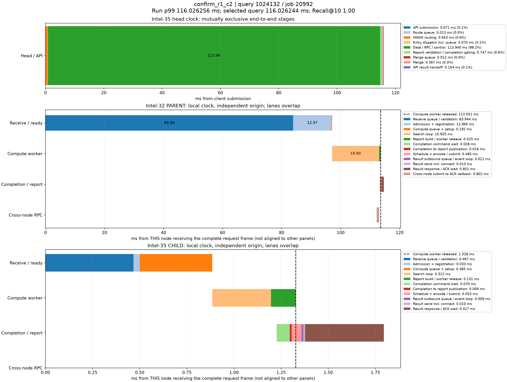

# p99真实查询时序分解

来源：confirm_r1_c2，50000条查询。在跨节点查询中选择最接近本轮全体查询p99的记录；这不是跨节点子集的p99。

本轮p99为116.026256310ms；query_id=1024132、job=20992，延迟116.026244000ms，相差0.000012310ms，Recall@10=1.00。

顶层面板使用同一主机时钟，阶段互斥且总和等于端到端服务延迟。每个数据节点单独以收到完整报文为零点，不能跨主机直接对齐时间轴或相加。节点内计算、控制、派发存在重叠；虚线表示计算线程释放时刻，之后的控制/网络等待不占用该计算线程。结果ACK时刻与用户Future完成时刻也不同。

|顶层阶段|耗时ms|占服务延迟|
|---|---:|---:|
|API submission|0.070895|0.06%|
|Route queue|0.013424|0.01%|
|HNSW routing|0.652756|0.56%|
|Entry dispatch incl. queue|0.069756|0.06%|
|Data / RPC / control|113.939620|98.20%|
|Report validation / completion gating|0.747387|0.64%|
|Merge queue|0.011588|0.01%|
|Merge|0.366843|0.32%|
|API result handoff|0.153975|0.13%|

## Intel-32 / PARENT

|阶段|本节点相对起点ms|耗时ms|
|---|---:|---:|
|Receive queue / validation|0.000000|83.943763|
|Admission + registration|83.943763|12.965425|
|Compute queue + setup|96.909188|0.191633|
|Search loop|97.100821|15.925240|
|Report build / worker release|113.026061|0.525386|
|Completion command wait|113.267975|0.028081|
|Completion to report publication|113.296056|0.015520|
|Schedule + encode / submit|113.311576|0.494556|
|Result outbound queue / event loop|113.806132|0.021435|
|Result send incl. connect|113.827567|0.012559|
|Result response / ACK wait|113.840126|0.800674|
|Cross-node submit to ACK callback|112.221806|0.802203|

## Intel-35 / CHILD

|阶段|本节点相对起点ms|耗时ms|
|---|---:|---:|
|Receive queue / validation|0.000000|0.466944|
|Admission + registration|0.466944|0.033398|
|Compute queue + setup|0.500342|0.384770|
|Search loop|0.885112|0.311740|
|Report build / worker release|1.196852|0.130789|
|Completion command wait|1.226212|0.070381|
|Completion to report publication|1.296593|0.008927|
|Schedule + encode / submit|1.305520|0.052554|
|Result outbound queue / event loop|1.358074|0.009360|
|Result send incl. connect|1.367434|0.010093|
|Result response / ACK wait|1.377527|0.417253|

结果RPC排队起点由 sender_enter_ns - round(pool_wait_ms * 1e6) 还原；pool_wait_ms来自底层同一主机时钟的queued_ns与send_start_ns之差。旧message_ready_ns是在异步提交成功后记录，网络线程可能已开始发送，不能用它直接计算发送前队列。还原数值保存在stages.json/CSV，未改写原始时间戳。

接收队列/验证、完成控制和发送前等待均为观测区间，可能包含OS调度及状态锁等待，不能据图将其全部认定为锁、CPU计算或纯链路传输。单条p99附近查询用于定位现象，不代表所有尾延迟样本。selected.json保留完整源记录，stages.json/CSV保存精确阶段数值。
