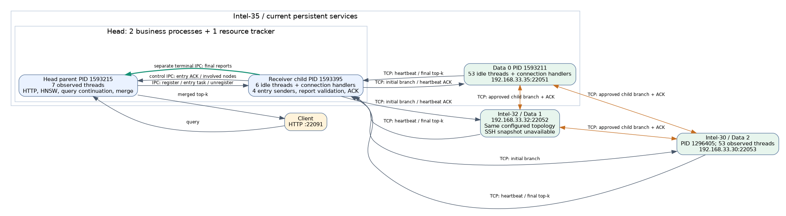
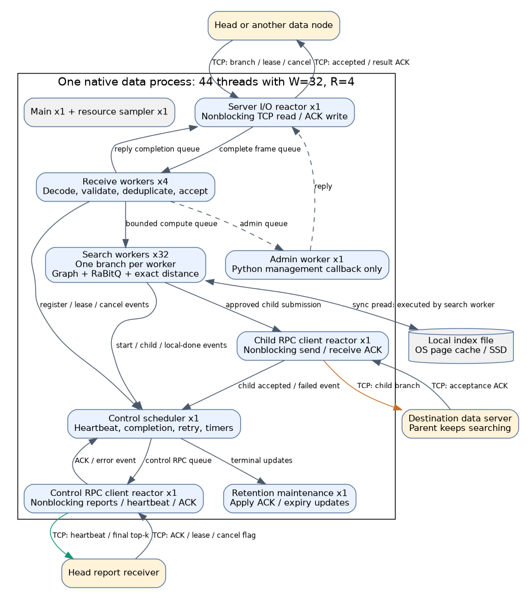
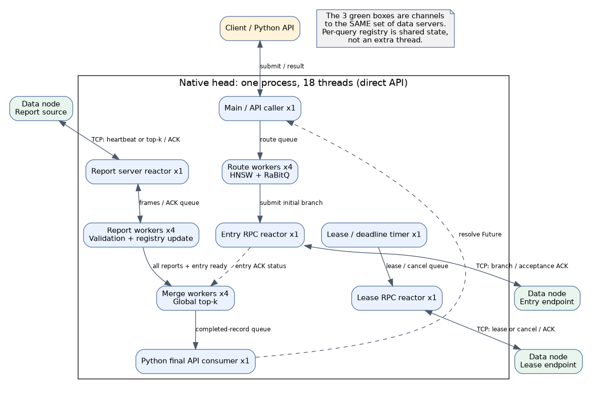
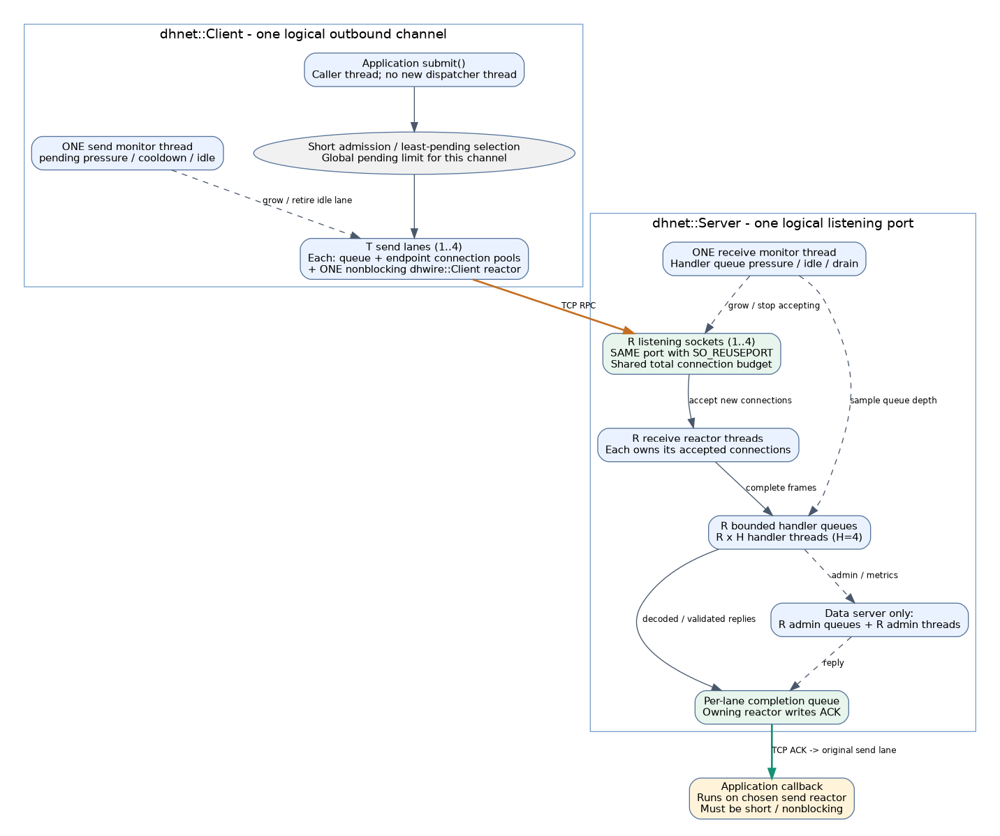
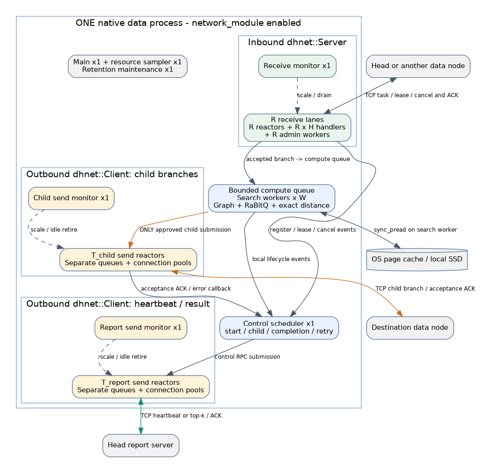
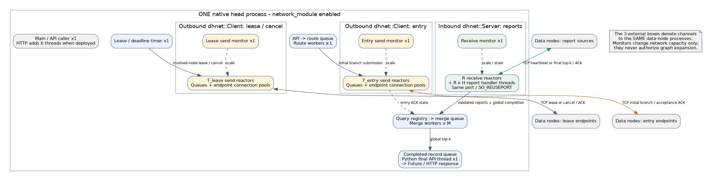

# 当前进程、线程与通信拓扑

**简洁总览：** [16:9 架构图与说明](overview_16x9/README.md)（一个详细顶层、一个详细数据节点、两个简化数据节点；含动态网络线程上下限）。

核对日期：2026-10-21。核对当前源码、常驻服务配置与进程列表，并对照最近 C++ 32/64 线程实验的配置和资源快照。这里只读取服务状态并绘图，没有启动性能负载或修改部署。

**新增网络模块已补入第10节。** 第1–9节中的44/18线程是此前关闭network_module时的实验记录；开启新模块后使用第10节的动态线程公式。新增图为 [数据节点](native_data_network.svg)、[顶层节点](native_head_network.svg)、[模块内部](network_module_detail.svg)。图表示当前源码结构，不将模块默认关闭误称为已在常驻服务启用。

## 1. 必须区分的两套部署

| 对象 | 当前常驻服务 | 最近全 C++ 实验路径 |
|---|---|---|
| 顶层 | Python 主进程 + 1 个独立报告接收子进程 | 一个业务进程，C++ 路由、报告校验、租约和合并 |
| 数据节点 | Python 接纳/派发 + native 搜索及控制 | 一个业务进程，接纳、调度、搜索、通信均走 C++ |
| 配置 | `test/managed_continuation_three_20261019/cluster.yaml` | `test/compute_w32_w64_20261020/three/00_w32/plan.yaml` |
| 开关 | 未启用 `native_runtime.data_enabled/head_enabled` | 两项均 true，旧 head_lanes/receiver 模式关闭 |
| 线程统计 | 本机数据53、顶层父7、顶层receiver子6；Intel-30数据53 | 实验快照每数据进程44、顶层直接API进程18 |

以上是两套**已实现**的路径，不能把其进程和线程数量叠加。配置模板 `configs/dhdgs.yaml` 中的默认值也不等于任何一次实验配置。

本轮 `ps` 观测：

- 本机数据0 PID 1593211，53线程；顶层父进程 PID 1593215，7线程；其报告接收子进程 PID 1593395，6线程。
- 另有 multiprocessing resource_tracker PID 1593394，1线程。它辅助回收进程资源，不处理查询。
- Intel-30 数据2 PID 1296405，53线程。
- Intel-32 按原SSH别名未及时返回；直连数据网地址的15秒限时探测超时，因此本轮没有取得该机进程快照。它的结构按相同配置解释，不声称本轮核实了实际PID/线程数。
- 上述线程数是快照。Python socketserver 的连接处理线程会随连接数改变；异常关闭、HTTP请求与管理任务也可能临时增加线程。

## 2. 物理主机和业务进程

Intel-35 同时部署顶层与数据0，二者是独立进程；Intel-32 部署数据1，Intel-30 部署数据2。顶层没有存储数据分片并执行完整 Disk 图搜索的职责。顶层保存 HNSW/样本路由、查询状态、分支报告并合并结果。



[可放大的 SVG](live_processes.svg)。该图的双向数据节点连线表示“任意方向都可能建立已授权分支”，不表示同一个 query 可以来回迁移；访问过的节点仍禁止重访。

常驻端点：HTTP `127.0.0.1:22091`；报告接收 `192.168.33.35:22080`；三个数据端点 `192.168.33.35:22051`、`192.168.33.32:22052`、`192.168.33.30:22053`。源端TCP通常使用临时端口。同机顶层→数据0仍经过TCP协议栈，但不等于跨物理网卡传输。

## 3. 常驻数据节点：一个进程，53个基础线程

| 线程角色 | 数量 | 工作与通信 |
|---|---:|---|
| 主线程 / TCP监听 | 1 | 接受连接；由 ThreadingTCPServer 为每个连接启动处理线程 |
| TCP连接处理线程 | 随连接数变化 | 一个线程循环接收该连接请求；处理 peer_submit、lease/cancel、metrics/admin；将接纳ACK写回原连接。不是只开一个接收工作线程 |
| 接纳消费者 | 1 | 从 admission_queue 取出已接纳分支，提交计算池；不运行完整查询 |
| 搜索计算线程 | 32 | 不同query/分支并行；一个本地分支固定在一个线程执行完整native循环、RaBitQ、精排和sync_pread |
| 子分支发送线程 | 16 | 从transfer队列取出扩展函数已批准的任务；发送至其他数据节点并等待接纳ACK；其等待不占搜索线程 |
| native控制调度线程 | 1 | 处理start/child/local-done/transfer-done、心跳、终态、重试和到期事件 |
| native控制网络reactor | 1 | 使用非阻塞TCP向顶层发送心跳/结果、接收ACK；一个线程复用多条连接 |
| 资源采样线程 | 1 | 采样进程CPU、RSS、物理读等，不承担搜索 |

基础总数：`1 + 1 + 32 + 16 + 1 + 1 + 1 = 53`，另加动态连接处理线程。

当前配置是native控制，因此 `communication.control_workers: 16` 并不代表另有16个Python控制发送线程；这条Python池没有创建。配置中的 `storage.io.worker_threads` 也不生效于sync_pread。thread对象被构造但未start，不能计为运行线程。

本地主要流转：

```text
连接处理线程 → admission_queue → 接纳消费者 → compute_queue → 搜索线程
搜索线程 → transfer_queue → 16个子分支发送线程 → 远端数据端点
搜索线程/发送回调 → native控制事件队列 → 控制线程 → 控制网络reactor → 顶层
```

发送接纳ACK的socketserver处理线程会进行同步socket写；搜索线程不会等待这个ACK。完成控制器等待子分支派发确认时，已结束本地搜索的计算线程可供其他query使用。

## 4. 常驻顶层：两个业务进程

父进程的7个已观测线程与配置对应：

| 角色 | 数量 | 工作 |
|---|---:|---|
| 主线程 / HTTP监听 | 1 | 接收外部HTTP连接；ThreadingHTTPServer另创建处理线程 |
| receiver IPC writer | 1 | 把start_query、注册/注销等命令写给子进程 |
| receiver控制IPC reader | 1 | 接收入口派发ACK、涉及节点等通知 |
| receiver终态IPC reader | 1 | 通过split独立管道接收完整终态报告包 |
| deadline watchdog | 1 | 管理父进程查询deadline和超时Future，不是图搜索线程 |
| QueryFlow stage线程 | 最多2 | HNSW路由、准备入口、结果聚合/续执行；网络等待期间挂起查询，不一直占用stage线程 |
| HTTP请求线程 | 动态 | 同步HTTP边界可能一直等待该请求结果；管理/benchmark请求也会占处理线程 |

独立receiver子进程的6个空闲基础线程：

| 角色 | 数量 | 工作 |
|---|---:|---|
| 子进程主线程 | 1 | 读取父进程IPC命令、创建session、把入口派发放入队列 |
| 报告TCP监听线程 | 1 | 接受数据节点的心跳/结果连接 |
| 入口派发线程 | 4 | 发送初始peer_submit，等待数据端接纳ACK，再通过控制IPC告知父进程 |
| 报告连接处理线程 | 动态 | 收取心跳/分支top-k、校验和ACK，记录涉及节点；完整时通过终态IPC发父进程 |

该旧路径没有单独的顶层主动lease网络线程；数据节点定期发心跳，顶层ACK携带lease信息，完成保活交互。取消/超时及管理可能使用额外控制RPC。不能将父进程deadline线程描述为定期发lease的线程。

只在终态时将报告包交回父进程进行merge；父子进程之间不会按每次图扩展传输frontier或距离候选。

## 5. 新C++数据节点：一个进程，44线程

最近32线程实验资源快照显示三个数据进程各44线程，与源码逐项相符。



[可放大的 SVG](native_data.svg)。图中每个方框是一类线程或资源；边上的queue/event是内存同步，不是TCP。

| 角色 | 数量 | 工作与归属 |
|---|---:|---|
| Python主线程 | 1 | 启动、生命周期；运行期间等待关闭 |
| C++入站server reactor | 1 | 接收连接、收集完整消息帧、发送接纳/lease/admin应答；持有入站socket |
| C++接收处理池 | 4 | 解码、校验、去重、接纳；接纳后放入计算队列，自己不执行图搜索 |
| C++管理处理线程 | 1 | 执行admin/metrics；必要时取得GIL调用Python管理逻辑，与普通query分离 |
| C++搜索池 | 32 | 一分支一线程，直接执行sync_pread、RaBitQ、精确距离；批准跨机后构造子分支并提交client |
| C++子分支client reactor | 1 | 非阻塞发送跨数据节点任务并接收接纳ACK，替代旧16个阻塞发送线程 |
| C++控制调度线程 | 1 | 分支事件、心跳、完成、发送额度、定时器与重试 |
| C++控制client reactor | 1 | 向顶层回报、接收ACK；与子分支client独立 |
| C++记录维护线程 | 1 | 同步ACK/expiry、回收保留记录，不执行图搜索 |
| Python资源采样线程 | 1 | 资源指标采样 |

总数 `W + R + 8`，W=32、R=4时为44；W=64时为76。配置修改时会按实际创建路径变化，不代表全系统线程数。

当前native runtime并未创建旧Python admission消费者和16线程transfer池；native_runtime开关生效后，旧参数不能重复计入。入口接纳直接提交C++计算队列。

搜索线程提交子分支时仍会执行状态/消息构造，当前Client.submit还包含编码；这段提交开销仍在调用线程上。独立reactor负责真实socket收发与ACK等待，不能把“网络等待解耦”说成搜索线程完全不做消息相关工作。

## 6. 新C++顶层：一个业务进程，直接API实验18线程



[可放大的 SVG](native_head.svg)。registry是共享状态，不是额外线程。Future完成通知和回调也不自动创建线程。

| 角色 | 数量 | 工作 |
|---|---:|---|
| 主/API调用线程 | 1 | 接收Python API提交并等待/消费结果；实验驱动在此进程内 |
| C++路由线程 | 4 | HNSW、样本RaBitQ、入口种子/预算生成 |
| C++入口client reactor | 1 | 发送初始任务、接收接纳ACK |
| C++报告server reactor | 1 | 接收数据节点心跳/报告帧，把验证后的ACK写回 |
| C++报告处理线程 | 4 | 解码、验证分支树/预算/身份、更新registry和涉及节点 |
| C++合并线程 | 4 | 所需报告和入口状态就绪后合并top-k、生成最终指标 |
| C++lease/deadline线程 | 1 | 根据涉及节点发起续租/取消，处理deadline和保留状态 |
| C++lease client reactor | 1 | 非阻塞发送lease/cancel、处理应答；与入口派发网络独立 |
| Python最终API消费线程 | 1 | `dhdgs-final-api` 从native完成队列取出结果，转换/交付并完成Future |

总数 `route_threads + merge_threads + receive_threads + 6 = 18`。最近实验的head进程快照确认为18，未额外启动lane或receiver子进程。

若使用 `tools/cluster_service.py head` 提供HTTP，还会新增4个HTTP解析线程、1个管理服务线程和1个HTTP回复线程，总计约24个基础线程。HTTP解析线程提交query后归还，不占着它等搜索结束；最终Future完成后回复线程发送HTTP结果。该数量不含实验报告后处理进程、临时统计拉取线程及库可能创建的辅助线程。

native_runtime.data_enabled和head_enabled可分别选择。上表以最近实验两者同时启用为准。

## 7. 通信边的完整含义

| 源→目的 | 机制 | 内容/触发 |
|---|---|---|
| 客户端→顶层HTTP边界 | HTTP/TCP | 查询向量或query行号；返回全局top-k |
| Python API→native路由队列 | 同进程函数调用+有界队列 | 查询、qid；不是网络 |
| 顶层路由→入口网络client | 同进程提交 | 一次初始分支，含query、seeds、预算、token、报告endpoint |
| 顶层入口client→数据入站server | TCP peer_submit | 数据端接纳入队后回ACK，不等待搜索完成 |
| 数据server→接收处理→搜索池 | 同进程队列 | 帧、接纳记录、待计算任务 |
| 搜索线程→本地文件 | sync_pread系统调用 | 指定offset的图记录；可能由OS页缓存返回，也可能下发物理SSD |
| 搜索线程→子分支client | 同进程提交 | 仅扩展函数批准后，传递本分支允许给目标节点的状态 |
| 数据A子分支client→数据B入站server | TCP peer_submit/ACK | 启动B的子分支；A继续搜索；B不继承A本地候选、不重访已访问节点 |
| 搜索线程→控制线程 | 同进程事件队列 | start、child、local-done、错误，不传回顶层逐跳frontier |
| 子分支client→控制线程 | 回调→事件队列 | 子分支接纳成功/失败，用于完成条件 |
| 数据控制client→顶层报告server | TCP heartbeat/result + ACK | involved_nodes、状态、最终本地top-k/统计；各分支直接向顶层报告 |
| 顶层lease client→数据server | TCP lease/cancel + ACK | 新native顶层主动保活、取消；不启动新图搜索 |
| 顶层registry→merge→完成队列→PythonAPI | 共享状态、队列、Future | 全局结束、top-k去重合并、最终交付 |
| 常驻顶层父进程↔receiver子进程 | Pipe IPC | 注册/派发/入口ACK/涉及节点，split管道发送终态报告包 |
| 管理端→各节点 | 管理RPC | 配置、暂停/恢复、快照等；不作为每个搜索步的协调链路 |

心跳/结果ACK、子分支接纳ACK、入口ACK是三种不同应答。一个TCP连接也不是一个计算线程；native reactor可复用多条连接。增加连接数量不要求等比例增加线程。

## 8. 一个跨两节点query如何运行

1. 顶层路由线程选中数据1，将初始分支交给入口client。
2. 数据1入站网络收完整帧，接收worker校验并入计算队列，再由入站网络回接纳ACK。
3. 数据1某个搜索worker执行本地分支。遇边界时由扩展函数判断；若批准数据2，构造子分支、分配预算、记录访问路径，提交子分支client。
4. 数据1的搜索worker继续剩余本地工作；数据2接纳后由自己的搜索worker执行子分支。此时同一个全局query可以同时占数据1和数据2各一个计算线程。
5. 数据1本地搜索结束后释放worker；其控制状态可以继续等待子分支接纳确认，不占住这个搜索worker。
6. 数据1、数据2各自把本地top-k直接回顶层；子分支结果不需要先绕回父节点再回顶层。
7. 顶层校验入口/分支状态、预算和完整性后，把merge任务交给合并池，最终交付API或HTTP回复线程。

“一查询一线程”在这里准确地指**一个节点上的一个搜索分支由一个计算线程执行**。全局query还有顶层路由/合并阶段、多个节点的并行分支和独立网络线程。当前sync_pread期间该搜索worker不能切到另一个query；跨query SSD聚合/协程调度并未因为有网络reactor就自动实现。

## 9. 来源与复现

- 当前源码：`python/dhdgs/cpp_runtime.py`、`cpp_head.py`、`peer.py`、`head_receivers.py`、`head_flow.py`、`head_http.py`；`cpp/native_runtime.cpp`、`native_head.cpp`、`native_server.cpp`、`native_control.cpp`、`native_wire.cpp`、`native_pool.hpp`。
- 实验线程快照：`test/compute_w32_w64_20261020/three/00_w32/runs/20261020T223154_benchmark_736c19e0/summary.json`，三个data的threads为44，head为18。
- 静态图源与重绘：本目录 `draw.py`、三个 `.dot` 文件；执行 `python3 draw.py` 生成SVG/PNG。
- 运行进程快照不等于Python内部线程名转储；常驻线程角色由配置和创建代码对照解释。源码有新改动不代表已经加载到旧常驻进程。

## 10. 新增native_network模块在完整线程架构中的位置

对应源码为 `cpp/native_network.hpp/.cpp`。`dhnet::Client` 封装一组 `dhwire::Client`，`dhnet::Server` 封装一组 `dhwire::Server`。模块在原业务进程中创建网络和监测线程，不新增独立网络进程。

新模块接入四个发送角色和两个接收角色：

| 业务位置 | 模块实例 | 服务内容 |
|---|---|---|
| 数据运行时 | 子分支 `dhnet::Client` | 扩展函数批准后的跨数据节点请求与接纳ACK |
| 数据控制器 | 报告 `dhnet::Client` | 心跳、分支最终top-k、错误报告及顶层ACK |
| 数据ManagedTransport | 入站 `dhnet::Server` | 入口/子分支、lease/cancel、admin/metrics和原连接应答 |
| 顶层运行时 | 入口 `dhnet::Client` | 初始分支派发与接纳ACK |
| 顶层运行时 | 租约 `dhnet::Client` | 主动lease/cancel与应答 |
| 顶层运行时 | 报告 `dhnet::Server` | 心跳/top-k接收、处理与ACK |

### 10.1 每个模块实例内部有什么线程



[可放大的SVG](network_module_detail.svg)。图中发送与接收模块之间是TCP；模块内部的选择、队列、回调和监测是同进程操作。

每个逻辑发送Client实例包含：

- **1个发送伸缩监测线程**，启用模块后才创建；每个Client独立监测，不是整个进程仅一个。
- **T个发送lane，每个lane有1个网络reactor线程**。每个lane拥有自己的请求队列、endpoint连接池、超时和在途状态。
- `submit()` 的容量预约和least-pending选择在调用线程上执行，**不是额外的派发线程**。从轮转起点选择pending较少的lane；提交仍执行底层编码工作。
- 选中的reactor负责连接、部分写、读应答与完成回调。回调运行在该reactor，必须短且不阻塞；应用事件随后交控制队列处理。

每个逻辑接收Server实例包含：

- **1个接收伸缩监测线程**。
- **R个接收lane，每个lane有1个网络reactor + H个请求处理线程**，拥有独立帧队列和应答完成队列。
- 数据服务每个lane另有**1个admin处理线程**；顶层报告Server没有admin handler，所以没有这组admin线程。
- 各lane用SO_REUSEPORT监听**同一个IP/端口**，由内核将新连接分配给某个lane。已建立连接继续由原reactor拥有，扩容不会把已有连接或query迁移到其他lane。
- `max_receive_connections` 是该监听Server所有lane共享的总连接上限；处理队列容量按lane配置。

这里“发送模块”和“接收模块”描述的是主动RPC客户端与RPC服务端的角色，**不是socket只能单向收发**：发送reactor会读ACK；接收reactor会写ACK。应答回到拥有原socket的reactor，不额外绕一遍另一套Client。

### 10.2 数据节点完整架构



[可放大的SVG](native_data_network.svg)。搜索池、控制器、维护线程仍在同一数据进程中；三个网络实例分别伸缩。

```text
入站Server：接收monitor ×1 + R ×（reactor ×1 + handler ×H + admin ×1）
子分支Client：发送monitor ×1 + T_child个reactor
报告Client：发送monitor ×1 + T_report个reactor
其他：搜索W + 控制1 + 记录维护1 + 主线程1 + 资源采样1

N_data = W + 7 + T_child + T_report + R × (H + 2)
```

以上公式适用于ManagedTransport、network_module开启、adaptive_control关闭的原生数据节点。保留的admin线程也计入，不把所有线程都叫搜索线程。

以W=32、H=4、发送/接收reactor各1–4为例：最小基础线程47，配置上界对应71；实际数量取决于各实例当时是否扩容、是否正在排空。旧版44没有计入这3个新增monitor，不能继续用于新模块开启后的进程。

数据路径为：接收reactor→本lane处理队列→接收worker→公共计算队列→某个搜索worker。获准子分支→子分支Client选择lane→远端数据Server；接纳ACK→原发送lane回调→控制事件。完成报告→报告Client→顶层报告Server。

SSD仍由搜索worker执行sync_pread；网络伸缩不增加搜索worker数量，也不批准额外远端扩展。

### 10.3 顶层节点完整架构



[可放大的SVG](native_head_network.svg)。外部三个数据方框表示同一组数据服务器的不同通信通道，不能当作新增三组机器。

```text
入口Client：发送monitor ×1 + T_entry个reactor
租约Client：发送monitor ×1 + T_lease个reactor
报告Server：接收monitor ×1 + R ×（reactor ×1 + handler ×H）
其他：路由L + 合并M + 租约/deadline1 + 主线程1 + Python最终API1

N_head_direct_API = L + M + 6 + T_entry + T_lease + R × (H + 1)
```

以L=4、M=4、H=4、各reactor数量1–4为例：直接API进程21–42线程；相同HTTP部署边界再加6，即27–48。此前18/24是关闭新模块时的数量。这里是源码推导的配置范围，不是新一次运行的线程测量。

网络模块不会取代顶层租约/deadline业务线程：租约线程决定给哪些已有分支续租/取消，租约Client只选择网络lane并执行通信。报告handler更新查询状态并触发merge，不能授权新的图搜索分支。

### 10.4 动态伸缩与连接容量

当前模板 `native_runtime.network_module` 默认关闭；enabled=true时才启用下面的伸缩策略。

| 参数/机制 | 含义 |
|---|---|
| send_min/max_reactors=1/4 | **每个逻辑Client**的发送lane范围，不是进程总共1–4条发送线程 |
| receive_min/max_reactors=1/4 | **每个逻辑Server**的接收lane范围 |
| handlers_per_receive_reactor=4 | 每新增一个接收lane，增加1个reactor和4个handler；数据服务还增加1个admin线程 |
| connections_per_endpoint_per_reactor=8 | 每个发送lane对每目标的连接上限；同一Client有T个lane时，配置上限为8T，不保证实际建满 |
| send_queue_capacity=4096 | 逻辑Client的pending总上限，同时受原业务通道max_pending限制；不是每新增lane都把总额度乘一次 |
| sample_interval_ms=20 | 监测周期，等待期间睡眠 |
| send_pending_high=8 | 任一发送lane的pending达到阈值；pending含排队及在途，不等同于纯CPU处理积压 |
| receive_queue_high=4 | 任一接收lane的handler等待队列达到阈值 |
| high_samples=2、cooldown_ms=100 | 持续高压且满足冷却后逐步增加lane |
| idle_ms=1000 | 空闲达到阈值后尝试缩容 |

发送缩容只回收没有pending工作的lane；接收缩容先停止该lane接受新连接，已有连接继续处理。等连接、活动handler和排队任务全部排空后才回收，不将排空等待误画成线程已删除。

`network_module` 与旧 `adaptive_control` 同时开启会被配置拒绝，因此图中没有叠加另一套控制lane伸缩。它们不是两套可以相乘的线程池。

新增图由 `python3 draw_network.py` 重绘；只新增文档与图表，没有调整服务配置、连接容量或查询扩展策略。
