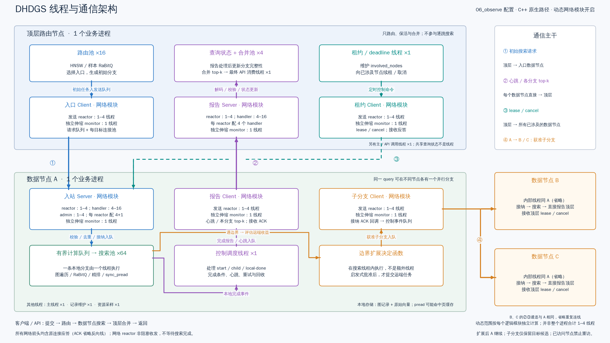

# DHDGS 16:9 线程架构总览

以最近完成的 `network_module_20261021/three/06_observe` 配置及源码快照为依据，绘制原生 C++ 路径：1 个展开的顶层进程、1 个展开的数据进程、2 个省略内部结构的数据进程。不是对当前常驻服务线程数的实时测量。没有调整任何运行配置。

[SVG 矢量图](architecture_16x9.svg)。PNG 尺寸为 3200×1800；SVG 为同一 16:9 画布。使用 `DHDGS/.venv/bin/python draw.py` 重绘（请按当前工作目录调整路径）。

## 阅读方式

- 蓝色：初始搜索派发、接纳与计算入队。
- 紫色：本地完成事件、心跳、各分支结果直接报告顶层，再合并交付。
- 青色虚线：顶层向已涉及的数据节点发送 lease/cancel；不启动图搜索。
- 橙色：搜索线程执行扩展决定函数；批准后经独立子分支 Client 派发到其他数据节点。
- 绿色框：固定 64 线程搜索池，一条本地分支由一个搜索线程执行。

为减少交叉线，ACK 的反向连接、简化节点 B/C 与顶层的重复报告/租约通道省略，改以框内文字和右侧图例说明。所有 RPC 都通过原连接返回应用层应答。子分支接纳回调在其发送 reactor 上执行，向控制事件队列发布成功/失败，不占用搜索线程等待网络。图中的短线交叉处不是汇合点。

顶层路由池 16 线程、合并池 4 线程，另有租约/deadline 1、主/API 调用 1、最终 API 消费 1。查询状态是共享数据，不是线程池。数据节点除搜索池外还有控制调度、记录维护、主线程、资源采样各 1。

## 动态网络线程上下限

|节点|逻辑模块|reactor 线程范围|请求 handler|admin handler|伸缩 monitor|
|---|---|---:|---:|---:|---:|
|顶层|入口 Client|1–4|0|0|1|
|顶层|租约 Client|1–4|0|0|1|
|顶层|报告 Server|1–4|4–16|0|1|
|数据|入站 Server|1–4|4–16|1–4|1|
|数据|子分支 Client|1–4|0|0|1|
|数据|报告 Client|1–4|0|0|1|

范围是每个逻辑模块独立计算；每个 Server lane 有 1 reactor 和 4 个 handler，数据入站另有 1 admin。每个 monitor 固定 1 个。按这次配置，顶层直接 API 进程的基础线程配置范围为 33–54，数据进程为 79–103；这些是配置推导，排空过程和其他部署边界应另外考虑，不能当作实际运行快照。

每个发送 lane 对每个目标最多 32 个连接，因此一个逻辑 Client 对每目标的配置连接上限随 lane 数从 32 到 128 变化，不表示会建满。Server lane 通过 SO_REUSEPORT 监听相同端口；扩容只分配新连接，旧连接不会迁移。缩容需要等待 lane 排空。

一个全局 query 可以在 A、B 各运行一个分支；A 派发后继续本地搜索，B 不继承 A 的本地候选，已访问节点不能重访。网络伸缩只调配通信资源，不授权远端扩展。当前搜索执行 sync_pread；网络线程不负责 SSD 请求聚合。

更详细的源码对应与线程公式见[原架构文档第 10 节](../README.md#10-新增native_network模块在完整线程架构中的位置)。
