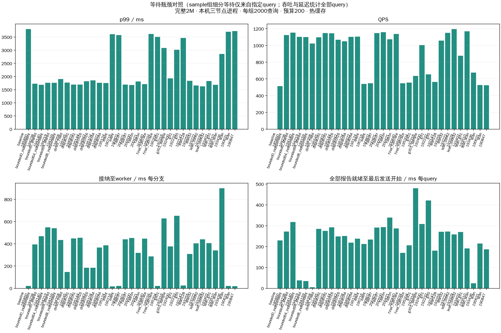

# 等待瓶颈对照的详细时间戳审计

注意：gil01_sample组以下启动和边界分组仅统计查询734744；lean/bounded/dispatch组开启了全体生命周期跟踪，时间戳统计全部2000查询，逐批次明细仍只选734744。全体延迟、QPS和召回始终统计2000查询。完整正确性审计另见all_runs_verification.json，含trace_off组。

全部组使用同一2000查询集合、完整seq_2M索引、native搜索预算200、queued独立发送队列；本机三TCP数据进程、客户端并发上限2000、40次预热排除。搜索扩展决策、预算、每节点单次访问和固定分支线程语义保持一致。所有实验在原索引上复测，不重建索引。

## 所有运行

| 配置 | 轮次 | 成功 | Recall@10 | QPS | 平均ms | p99 ms |
|---|---|---|---|---|---|---|
| baseline | 185850 | 2000 | 97.020% | 513.42 | 1980.57 | 3802.15 |
| bounded0_independent | 194238 | 2000 | 97.015% | 1122.74 | 1403.21 | 1726.15 |
| bounded0_shared | 194140 | 2000 | 97.020% | 1153.58 | 1342.56 | 1683.31 |
| bounded64_independent | 194219 | 2000 | 97.020% | 1102.81 | 1176.88 | 1761.74 |
| bounded64_shared | 194159 | 2000 | 97.010% | 1100.85 | 1217.25 | 1758.34 |
| bounded8_independent | 194258 | 2000 | 97.015% | 1021.85 | 1338.81 | 1902.17 |
| direct_fixed | 195545 | 2000 | 97.020% | 1096.82 | 1451.29 | 1766.93 |
| dispatch1 | 194903 | 2000 | 97.010% | 1146.60 | 1338.31 | 1688.58 |
| dispatch1 | 195144 | 2000 | 97.000% | 1143.77 | 1346.04 | 1689.66 |
| dispatch16 | 194942 | 2000 | 97.005% | 1068.01 | 1497.77 | 1816.44 |
| dispatch16 | 195104 | 2000 | 97.040% | 1050.08 | 1522.71 | 1853.64 |
| dispatch4 | 194922 | 2000 | 96.985% | 1101.48 | 1473.74 | 1761.71 |
| dispatch4 | 195124 | 2000 | 97.040% | 1104.97 | 1455.03 | 1755.08 |
| event | 190716 | 2000 | 97.020% | 540.53 | 1877.56 | 3612.02 |
| event | 190802 | 2000 | 97.050% | 547.30 | 1887.33 | 3571.45 |
| fastoff | 200401 | 2000 | 96.995% | 1147.83 | 1331.62 | 1689.73 |
| fastoff | 200500 | 2000 | 97.010% | 1159.10 | 1314.70 | 1673.59 |
| faston | 200421 | 2000 | 97.050% | 1072.44 | 1460.24 | 1808.32 |
| faston | 200440 | 2000 | 97.005% | 1137.58 | 1348.94 | 1706.37 |
| final_fulltrace | 195034 | 2000 | 97.025% | 548.10 | 1867.00 | 3613.60 |
| final_fulltrace | 195204 | 2000 | 97.070% | 555.29 | 1841.16 | 3508.58 |
| gil01 | 192316 | 2000 | 97.005% | 635.35 | 2460.07 | 3080.87 |
| gil01_sample | 192400 | 2000 | 96.990% | 1005.67 | 1622.27 | 1931.13 |
| gil1 | 192232 | 2000 | 96.990% | 654.73 | 2376.74 | 3016.48 |
| gil5 | 192147 | 2000 | 96.975% | 564.22 | 1842.64 | 3462.83 |
| lean128 | 193255 | 2000 | 97.035% | 1056.34 | 1551.67 | 1838.90 |
| lean32 | 193222 | 2000 | 96.995% | 1150.32 | 1386.60 | 1659.94 |
| lean_conn2 | 193329 | 2000 | 97.055% | 1195.42 | 1308.87 | 1622.58 |
| lean_conn32 | 193402 | 2000 | 97.030% | 876.73 | 1468.50 | 1831.71 |
| lean_gil1 | 193510 | 2000 | 97.025% | 1169.45 | 1373.92 | 1681.27 |
| lean_scan | 193436 | 2000 | 97.025% | 676.45 | 1498.40 | 2860.84 |
| scan | 190631 | 2000 | 97.030% | 526.85 | 1947.73 | 3701.85 |
| scan | 190847 | 2000 | 97.030% | 523.65 | 1918.75 | 3722.67 |

## 启动等待（分支均值）

| 配置 | 轮次 | 建线程次数 | submit ms | 接纳至worker ms | worker至C++ ms | 服务启动s |
|---|---|---|---|---|---|---|
| baseline | 185850 | 0 | 0.0189 | 21.78 | 0.78 | 16.71 |
| bounded0_independent | 194238 | 0 | 0.0661 | 393.75 | 2.26 | 2.93 |
| bounded0_shared | 194140 | 0 | 0.0706 | 467.54 | 1.83 | 2.91 |
| bounded64_independent | 194219 | 0 | 0.0663 | 548.81 | 2.37 | 2.90 |
| bounded64_shared | 194159 | 0 | 0.0510 | 540.81 | 2.27 | 2.91 |
| bounded8_independent | 194258 | 0 | 0.0619 | 434.12 | 2.91 | 2.89 |
| direct_fixed | 195545 | 0 | 0.1524 | 146.97 | 14.96 | 2.90 |
| dispatch1 | 194903 | 0 | 0.0483 | 448.88 | 2.36 | 2.92 |
| dispatch1 | 195144 | 0 | 0.0638 | 454.84 | 2.03 | 2.93 |
| dispatch16 | 194942 | 0 | 0.0614 | 185.80 | 18.78 | 2.94 |
| dispatch16 | 195104 | 0 | 0.1569 | 185.68 | 19.57 | 2.94 |
| dispatch4 | 194922 | 0 | 0.0499 | 366.92 | 6.19 | 2.92 |
| dispatch4 | 195124 | 0 | 0.0485 | 386.86 | 6.25 | 2.94 |
| event | 190716 | 0 | 0.0187 | 17.81 | 0.75 | 16.82 |
| event | 190802 | 0 | 0.0175 | 21.47 | 0.69 | 16.82 |
| fastoff | 200401 | 0 | 0.0452 | 439.79 | 2.92 | 2.94 |
| fastoff | 200500 | 0 | 0.0421 | 451.51 | 1.93 | 2.94 |
| faston | 200421 | 0 | 0.0410 | 318.06 | 2.23 | 2.94 |
| faston | 200440 | 0 | 0.0726 | 445.98 | 2.09 | 2.93 |
| final_fulltrace | 195034 | 0 | 0.0188 | 286.26 | 5.60 | 2.92 |
| final_fulltrace | 195204 | 0 | 0.0549 | 22.02 | 0.73 | 2.93 |
| gil01 | 192316 | 0 | 0.0531 | 628.66 | 6.02 | 16.65 |
| gil01_sample | 192400 | 0 | 0.0129 | 376.45 | 3.40 | 16.66 |
| gil1 | 192232 | 0 | 0.0240 | 652.79 | 2.51 | 16.66 |
| gil5 | 192147 | 0 | 0.0187 | 24.60 | 0.87 | 16.64 |
| lean128 | 193255 | 0 | 0.3519 | 308.45 | 2.73 | 16.87 |
| lean32 | 193222 | 0 | 0.0397 | 403.80 | 3.06 | 16.69 |
| lean_conn2 | 193329 | 0 | 0.0326 | 439.82 | 1.78 | 16.75 |
| lean_conn32 | 193402 | 0 | 0.0551 | 407.41 | 2.40 | 16.55 |
| lean_gil1 | 193510 | 0 | 0.0532 | 340.14 | 1.22 | 16.64 |
| lean_scan | 193436 | 0 | 0.0297 | 899.96 | 5.01 | 16.70 |
| scan | 190631 | 0 | 0.0178 | 20.50 | 0.78 | 16.74 |
| scan | 190847 | 0 | 0.0195 | 19.76 | 0.76 | 16.80 |

## 端到端时间的互斥分组（query均值）

用同一单调时钟域的绝对事件切分：客户端开始→根分支接纳→全部分支报告就绪→最后结果发送边界→API返回。发送边界取max(全部报告就绪,最后结果sender_enter)，处理排队心跳升级为结果的情况。四项之和等于平均查询延迟，含实际工作与等待，不能当纯等待或再加累计分支耗时。

| 配置 | 轮次 | 入口到接纳ms | 接纳至报告齐备ms | 报告齐备至发送ms | 发送开始至返回ms |
|---|---|---|---|---|---|
| baseline | 185850 | 1143.43 | 596.31 | 229.59 | 11.24 |
| bounded0_independent | 194238 | 192.27 | 934.20 | 272.49 | 4.25 |
| bounded0_shared | 194140 | 146.66 | 873.91 | 317.72 | 4.28 |
| bounded64_independent | 194219 | 164.94 | 968.68 | 38.14 | 5.12 |
| bounded64_shared | 194159 | 175.93 | 1001.40 | 34.68 | 5.24 |
| bounded8_independent | 194258 | 185.89 | 1143.67 | 4.94 | 4.30 |
| direct_fixed | 195545 | 332.91 | 828.20 | 285.00 | 5.17 |
| dispatch1 | 194903 | 169.29 | 889.54 | 275.33 | 4.16 |
| dispatch1 | 195144 | 160.45 | 888.98 | 292.70 | 3.90 |
| dispatch16 | 194942 | 309.45 | 934.52 | 248.66 | 5.14 |
| dispatch16 | 195104 | 305.98 | 960.24 | 251.06 | 5.43 |
| dispatch4 | 194922 | 207.65 | 1042.96 | 218.76 | 4.37 |
| dispatch4 | 195124 | 182.12 | 1030.50 | 237.60 | 4.81 |
| event | 190716 | 1153.81 | 502.72 | 211.98 | 9.05 |
| event | 190802 | 1142.50 | 501.76 | 233.57 | 9.50 |
| fastoff | 200401 | 182.75 | 853.16 | 291.66 | 4.05 |
| fastoff | 200500 | 155.93 | 861.30 | 293.49 | 3.97 |
| faston | 200421 | 227.44 | 888.64 | 339.07 | 5.09 |
| faston | 200440 | 175.95 | 882.27 | 286.51 | 4.21 |
| final_fulltrace | 195034 | 916.58 | 766.83 | 169.64 | 13.95 |
| final_fulltrace | 195204 | 1101.76 | 523.79 | 205.81 | 9.80 |
| gil01 | 192316 | 410.11 | 1563.17 | 479.69 | 7.11 |
| gil01_sample | 192400 | 377.31 | 1059.19 | 307.75 | 5.94 |
| gil1 | 192232 | 465.19 | 1482.51 | 421.20 | 7.83 |
| gil5 | 192147 | 1099.60 | 552.42 | 180.61 | 10.00 |
| lean128 | 193255 | 270.87 | 1004.13 | 271.42 | 5.26 |
| lean32 | 193222 | 222.33 | 887.63 | 272.17 | 4.47 |
| lean_conn2 | 193329 | 161.46 | 884.67 | 258.41 | 4.33 |
| lean_conn32 | 193402 | 265.49 | 927.12 | 270.08 | 5.82 |
| lean_gil1 | 193510 | 356.66 | 820.71 | 190.79 | 5.76 |
| lean_scan | 193436 | 216.17 | 1252.31 | 24.20 | 5.72 |
| scan | 190631 | 1167.30 | 555.50 | 214.38 | 10.55 |
| scan | 190847 | 1159.95 | 561.17 | 187.28 | 10.35 |

## 结果RPC阶段（每次结果发送均值）

pool_wait包含借用、容量等待与空闲连接健康探测及调度，不是纯容量等待；send/response也不是纯网络时间。

| 配置 | 轮次 | pool ms | connect ms | send ms | response ms |
|---|---|---|---|---|---|
| baseline | 185850 | 0.356 | 2.658 | 12.117 | 16.610 |
| bounded0_independent | 194238 | 0.180 | 0.038 | 0.588 | 1.132 |
| bounded0_shared | 194140 | 0.475 | 0.032 | 0.578 | 1.172 |
| bounded64_independent | 194219 | 0.218 | 0.041 | 0.621 | 1.007 |
| bounded64_shared | 194159 | 0.295 | 0.037 | 0.653 | 1.046 |
| bounded8_independent | 194258 | 0.120 | 0.043 | 0.777 | 1.272 |
| direct_fixed | 195545 | 0.850 | 0.098 | 0.581 | 1.819 |
| dispatch1 | 194903 | 0.098 | 0.075 | 0.637 | 0.977 |
| dispatch1 | 195144 | 0.153 | 0.048 | 0.574 | 1.055 |
| dispatch16 | 194942 | 1.215 | 0.159 | 0.642 | 1.620 |
| dispatch16 | 195104 | 0.801 | 0.105 | 0.652 | 1.977 |
| dispatch4 | 194922 | 0.956 | 0.070 | 0.539 | 1.238 |
| dispatch4 | 195124 | 0.884 | 0.132 | 0.593 | 1.498 |
| event | 190716 | 0.377 | 2.213 | 10.485 | 15.633 |
| event | 190802 | 0.290 | 2.323 | 10.668 | 15.607 |
| fastoff | 200401 | 0.149 | 0.043 | 0.582 | 1.025 |
| fastoff | 200500 | 0.117 | 0.039 | 0.606 | 1.089 |
| faston | 200421 | 0.659 | 0.042 | 0.627 | 1.581 |
| faston | 200440 | 0.223 | 0.031 | 0.601 | 1.143 |
| final_fulltrace | 195034 | 0.217 | 1.671 | 7.356 | 11.117 |
| final_fulltrace | 195204 | 0.423 | 2.381 | 11.181 | 16.743 |
| gil01 | 192316 | 0.096 | 0.077 | 1.242 | 2.265 |
| gil01_sample | 192400 | 0.021 | 0.000 | 0.921 | 47.930 |
| gil1 | 192232 | 0.089 | 0.691 | 2.774 | 5.569 |
| gil5 | 192147 | 0.312 | 2.756 | 10.371 | 14.699 |
| lean128 | 193255 | 0.353 | 0.150 | 0.546 | 2.616 |
| lean32 | 193222 | 0.171 | 0.071 | 0.517 | 1.607 |
| lean_conn2 | 193329 | 0.706 | 0.042 | 0.618 | 1.389 |
| lean_conn32 | 193402 | 0.084 | 0.105 | 0.507 | 2.785 |
| lean_gil1 | 193510 | 0.113 | 0.766 | 1.919 | 4.417 |
| lean_scan | 193436 | 0.059 | 0.041 | 0.548 | 1.090 |
| scan | 190631 | 0.196 | 3.070 | 11.986 | 17.197 |
| scan | 190847 | 0.352 | 2.700 | 10.967 | 16.892 |

所有运行的逐分支、关键路径CSV、固定查询734744原始事件及审计保存在analysis/配置/运行目录。
资源使用、协议字节、服务启动耗时与物理读取增量见comparison.json；完整queries.csv、阶段均值、进程负载见各组runs目录。
本轮是热页缓存突发负载，不代表物理三机、冷SSD或稳态容量；详细trace开销已通过trace_off/选择性trace组消融。预启动把线程创建成本移至服务启动，不是将其消除。
